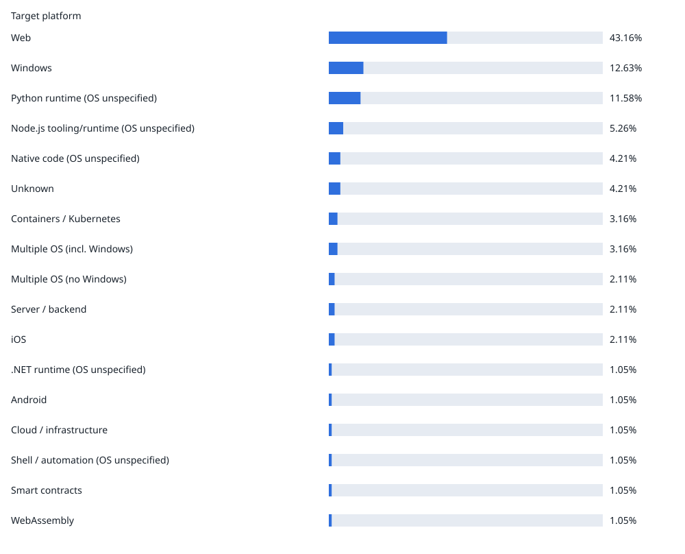
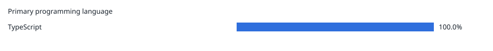

# Windows app discovery — latest report

Activity window (UTC): 2026-09-22T19:00:00Z → 2026-10-22T19:00:00Z
Generated: 2026-10-22T22:47:50Z  
Ruleset: pilot-4; Application Inspector: 1.10.2

Uniform random sample from 371361 public repositories with qualifying human activity.
Seed: 2026-10-22T19:00:00Z; archive hours: 720/720; qualifying events: 1219689; deleted/private replacements: 2.
95% Wilson confidence intervals; worst-case margin for complete scans: ±9.95 percentage points.

| Metric | Repositories |
| --- | ---: |
| Sampled | 100 |
| Complete scans | 97 |
| Partial | 0 |
| Failed | 0 |
| No eligible source | 3 |
| Windows candidates (subset of complete scans) | 19 |
| Windows applications (subset of complete scans) | 11 |

## Target platform

One primary platform per repository: an explicit OS target wins, several OS targets = Multiple OS, otherwise the most specific environment; generic runtimes/scripts come last.

Each repository belongs to one category; shares total 100% across the 97 complete scans only. Partial, failed, and no-eligible-source repositories are excluded.

| Category | Count / denominator | Share | CI |
| --- | ---: | ---: | --- |
| Web | 39 / 97 | 40.21% | 31.0–50.16% |
| Python runtime \(OS unspecified\) | 12 / 97 | 12.37% | 7.22–20.39% |
| Windows | 11 / 97 | 11.34% | 6.45–19.17% |
| Multiple OS \(incl. Windows\) | 8 / 97 | 8.25% | 4.24–15.44% |
| Containers / Kubernetes | 3 / 97 | 3.1% | 1.06–8.7% |
| Linux | 3 / 97 | 3.1% | 1.06–8.7% |
| Native code \(OS unspecified\) | 3 / 97 | 3.09% | 1.06–8.7% |
| Unknown | 3 / 97 | 3.09% | 1.06–8.7% |
| macOS | 3 / 97 | 3.09% | 1.06–8.7% |
| .NET runtime \(OS unspecified\) | 2 / 97 | 2.06% | 0.57–7.21% |
| Node.js tooling/runtime \(OS unspecified\) | 2 / 97 | 2.06% | 0.57–7.21% |
| Shell / automation \(OS unspecified\) | 2 / 97 | 2.06% | 0.57–7.21% |
| iOS | 2 / 97 | 2.06% | 0.57–7.21% |
| Cloud / infrastructure | 1 / 97 | 1.03% | 0.18–5.61% |
| JVM \(OS unspecified\) | 1 / 97 | 1.03% | 0.18–5.61% |
| Multiple OS \(no Windows\) | 1 / 97 | 1.03% | 0.18–5.61% |
| Smart contracts | 1 / 97 | 1.03% | 0.18–5.61% |

## Primary programming language

GitHub's primary language per repository.

Each repository belongs to one category; shares total 100% across the 97 complete scans only. Partial, failed, and no-eligible-source repositories are excluded.

| Category | Count / denominator | Share | CI |
| --- | ---: | ---: | --- |
| TypeScript | 23 / 97 | 23.71% | 16.35–33.07% |
| Python | 17 / 97 | 17.53% | 11.24–26.29% |
| Rust | 10 / 97 | 10.31% | 5.7–17.95% |
| JavaScript | 9 / 97 | 9.28% | 4.96–16.7% |
| C# | 4 / 97 | 4.13% | 1.62–10.13% |
| HTML | 4 / 97 | 4.13% | 1.62–10.13% |
| Java | 4 / 97 | 4.13% | 1.62–10.13% |
| Swift | 4 / 97 | 4.12% | 1.62–10.13% |
| Go | 3 / 97 | 3.09% | 1.06–8.7% |
| Shell | 3 / 97 | 3.09% | 1.06–8.7% |
| Dart | 2 / 97 | 2.06% | 0.57–7.21% |
| Nix | 2 / 97 | 2.06% | 0.57–7.21% |
| Astro | 1 / 97 | 1.03% | 0.18–5.61% |
| Batchfile | 1 / 97 | 1.03% | 0.18–5.61% |
| C | 1 / 97 | 1.03% | 0.18–5.61% |
| C++ | 1 / 97 | 1.03% | 0.18–5.61% |
| Clojure | 1 / 97 | 1.03% | 0.18–5.61% |
| Groovy | 1 / 97 | 1.03% | 0.18–5.61% |
| Jupyter Notebook | 1 / 97 | 1.03% | 0.18–5.61% |
| MDX | 1 / 97 | 1.03% | 0.18–5.61% |
| PHP | 1 / 97 | 1.03% | 0.18–5.61% |
| PLpgSQL | 1 / 97 | 1.03% | 0.18–5.61% |
| QML | 1 / 97 | 1.03% | 0.18–5.61% |
| YAML | 1 / 97 | 1.03% | 0.18–5.61% |

## Framework evidence

Most specific detected framework per repository (e.g. Next.js before React).

Each repository belongs to one category; shares total 100% across the 97 complete scans only. Partial, failed, and no-eligible-source repositories are excluded.

| Category | Count / denominator | Share | CI |
| --- | ---: | ---: | --- |
| No framework detected | 56 / 97 | 57.74% | 47.79–67.08% |
| React | 12 / 97 | 12.37% | 7.22–20.39% |
| Next.js | 11 / 97 | 11.34% | 6.45–19.17% |
| Electron | 3 / 97 | 3.1% | 1.06–8.7% |
| Express | 2 / 97 | 2.06% | 0.57–7.21% |
| Flutter | 2 / 97 | 2.06% | 0.57–7.21% |
| React Native | 2 / 97 | 2.06% | 0.57–7.21% |
| Spring Boot | 2 / 97 | 2.06% | 0.57–7.21% |
| Svelte | 2 / 97 | 2.06% | 0.57–7.21% |
| Windows Forms | 2 / 97 | 2.06% | 0.57–7.21% |
| Angular | 1 / 97 | 1.03% | 0.18–5.61% |
| FastAPI | 1 / 97 | 1.03% | 0.18–5.61% |
| Vue | 1 / 97 | 1.03% | 0.18–5.61% |

## Project application and automation types

Share of complete repository scans with collected project findings, including libraries/tools and non-Windows PowerShell. Each repository counts once per category across its projects. Categories overlap: Windows desktop app includes Windows Forms, WPF, WinUI, and UWP; shares need not sum to 100%. Older inventories without project findings are excluded. Static indicators do not prove executable or runtime behavior.

| Category | Count / denominator | Share | CI |
| --- | ---: | ---: | --- |
| PowerShell | 5 / 97 | 5.15% | 2.22–11.5% |
| Cross-platform: Electron | 3 / 97 | 3.09% | 1.06–8.7% |
| Cross-platform: Flutter | 2 / 97 | 2.06% | 0.57–7.21% |
| Cross-platform: React Native | 2 / 97 | 2.06% | 0.57–7.21% |
| Service management | 2 / 97 | 2.06% | 0.57–7.21% |
| Windows Forms app | 2 / 97 | 2.06% | 0.57–7.21% |
| Windows desktop app | 2 / 97 | 2.06% | 0.57–7.21% |
| UWP app | 0 / 97 | 0.0% | 0.0–3.81% |
| WPF app | 0 / 97 | 0.0% | 0.0–3.81% |
| WinUI app | 0 / 97 | 0.0% | 0.0–3.81% |
| Windows service | 0 / 97 | 0.0% | 0.0–3.81% |

Classification coverage: 84 repositories had no recognized application type under
the original `pilot-4` rules. They remain in the denominator. The broader
source-based application and automation classification requires a fresh scan with
`pilot-5`; platform labels alone cannot establish these application types.

## Windows application types

Complete Windows application scans; types can overlap.

| Category | Count / denominator | Share | CI |
| --- | ---: | ---: | --- |
| Native / Win32 \(UI not proven\) | 7 / 11 | 63.64% | 35.38–84.83% |
| PowerShell install script | 3 / 11 | 27.27% | 9.75–56.56% |
| PowerShell script | 3 / 11 | 27.27% | 9.75–56.56% |
| Windows Forms | 2 / 11 | 18.18% | 5.14–47.7% |
| Cross-platform: Electron | 1 / 11 | 9.09% | 1.62–37.74% |
| Cross-platform: Flutter | 1 / 11 | 9.09% | 1.62–37.74% |
| Service management | 1 / 11 | 9.09% | 1.62–37.74% |

## Windows component adoption

Complete Windows application scans; components overlap.

| Category | Count / denominator | Share | CI |
| --- | ---: | ---: | --- |
| Win32 | 9 / 11 | 81.82% | 52.3–94.86% |
| COM | 3 / 11 | 27.27% | 9.75–56.56% |
| .NET native interop | 2 / 11 | 18.18% | 5.14–47.7% |
| Windows Registry | 2 / 11 | 18.18% | 5.14–47.7% |
| DirectX | 1 / 11 | 9.09% | 1.62–37.74% |
| Windows Shell | 1 / 11 | 9.09% | 1.62–37.74% |
| WinRT | 0 / 11 | 0.0% | 0.0–25.88% |
| Windows services | 0 / 11 | 0.0% | 0.0–25.88% |

## Exploratory: all Windows candidates

Includes libraries/tools; not an application metric.

| Category | Count / denominator | Share | CI |
| --- | ---: | ---: | --- |
| Win32 | 16 / 19 | 84.21% | 62.43–94.48% |
| COM | 4 / 19 | 21.05% | 8.51–43.33% |
| .NET native interop | 3 / 19 | 15.79% | 5.52–37.57% |
| Windows Registry | 3 / 19 | 15.79% | 5.52–37.57% |
| DirectX | 1 / 19 | 5.26% | 0.94–24.64% |
| Windows Shell | 1 / 19 | 5.26% | 0.94–24.64% |
| Windows services | 1 / 19 | 5.26% | 0.94–24.64% |
| WinRT | 0 / 19 | 0.0% | 0.0–16.82% |

## Sampled repositories

| Repository | Scan | Language | Platform | Framework | Windows app types | Components |
| --- | --- | --- | --- | --- | --- | --- |
| zengqi7/event-workflow-platform | success | Go | Containers / Kubernetes | No framework detected | PowerShell script |  |
| servo/ci-runners | success | Rust | Web | No framework detected |  |  |
| jerryfane/slidehex | success | TypeScript | Web | React |  |  |
| gardener/gardener-extension-image-rewriter | success | Go | Containers / Kubernetes | No framework detected |  |  |
| SkaleAgents/mcp-server | success | TypeScript | Node.js tooling/runtime \(OS unspecified\) | React |  |  |
| AustralianCyberSecurityCentre/azul-webui | success | TypeScript | Web | Angular |  |  |
| hakan-demirli/dotfiles | success | Nix | Web | No framework detected |  |  |
| danielcashion/CollegeAthleteNetwork | success | TypeScript | Web | Next.js |  |  |
| jak-pan/swarmpit | success | Clojure | Windows | No framework detected | Native / Win32 \(UI not proven\) | Win32 |
| IliaTrofimov/PrettyMachines | success | C# | Windows | No framework detected | Native / Win32 \(UI not proven\) | Win32 |
| Nextrum10/neutrum-sajt | success | PLpgSQL | Web | No framework detected |  |  |
| MontiCore/monticore | success | Java | Windows | No framework detected | Native / Win32 \(UI not proven\) | Win32 |
| pulltheorytcg/drop-rate-backend | success | Python | Web | React Native | Cross-platform: React Native |  |
| egovernments/Citizen-Complaint-Resolution-System | success | JavaScript | Windows | React | Native / Win32 \(UI not proven\) | Win32 |
| NatePombi/SD\_6\_IroncladPasswordManager\_byte | success | Java | Unknown | No framework detected |  |  |
| EVERYTHING-studios/infra-aws | success | TypeScript | Cloud / infrastructure | No framework detected |  |  |
| andrewjgcoward-dot/fll-bioglow-simulator | success | JavaScript | Web | No framework detected |  |  |
| taskade/integrations | success | TypeScript | Node.js tooling/runtime \(OS unspecified\) | No framework detected |  |  |
| pid1/fridgefriend | success | Python | Python runtime \(OS unspecified\) | No framework detected |  |  |
| Harflow-Dev/HarflowMac | success | Swift | macOS | No framework detected |  |  |
| stordik-alt/Shopping\_Buddy | success | TypeScript | Web | React Native | Cross-platform: React Native |  |
| CCA3370/XFast-Manager | success | Rust | Windows | Vue | Console / other / unknown | COM |
| funkymonkeymonk/nix | success | Nix | Python runtime \(OS unspecified\) | No framework detected |  |  |
| crspytopgn/opensgolf | success | Rust | Linux | No framework detected |  |  |
| mragungsetiaji/wednesday | success | Python | Web | Next.js | PowerShell install script, PowerShell script |  |
| rajbos/GitHub-ratelimit-research | not\_applicable | Unknown | Unknown | No framework detected |  |  |
| ngocnhanvo/nghiencuukhoahoc-actions | success | Python | Python runtime \(OS unspecified\) | No framework detected |  |  |
| Project-Muteki/besta-tools | success | Python | Python runtime \(OS unspecified\) | No framework detected |  |  |
| Tuannvtse161029/FE\_ARS | success | TypeScript | Web | Svelte |  |  |
| pbrissonnneau/overdue | success | Dart | Multiple OS \(incl. Windows\) | Flutter | Cross-platform: Flutter | COM, Win32 |
| bhartnell/pmi-scheduler | success | TypeScript | Web | Next.js |  |  |
| apache/grails-gradle-publish | success | Groovy | JVM \(OS unspecified\) | No framework detected |  |  |
| turong-dev/drumsynth | success | Rust | Native code \(OS unspecified\) | No framework detected |  |  |
| PillB/vocal-singing-training | success | JavaScript | Web | Next.js |  |  |
| dmikusa/binding-tool | success | Rust | Linux | No framework detected |  |  |
| isabelSoares/myWebSite | success | Shell | Web | React |  |  |
| nikolmedo/ClaudePulse | success | Python | Python runtime \(OS unspecified\) | No framework detected |  |  |
| OctoSense-org/OctoSense | success | Rust | Multiple OS \(incl. Windows\) | Next.js | Native / Win32 \(UI not proven\) | Win32 |
| benaja-bendo/mibeko-site | success | Astro | Web | Express |  |  |
| kzarzycki/project-templates | success | Python | Shell / automation \(OS unspecified\) | No framework detected |  |  |
| usedhonda/tproj | success | Shell | macOS | No framework detected |  |  |
| ActivityWatch/stats | success | Python | Web | Next.js |  |  |
| JuanButlerL/iq-ecommerce | success | TypeScript | Web | Next.js |  |  |
| jayporta/daily-game | success | TypeScript | Web | React |  |  |
| dokieli/dokieli | success | JavaScript | Web | No framework detected |  |  |
| jussisaurio/perennial | success | TypeScript | Web | Next.js |  |  |
| hrz6976/cpa-plugin-opencode-go-pool | success | Go | Native code \(OS unspecified\) | No framework detected |  |  |
| BasharMithan/VerChain | success | Python | Web | FastAPI |  |  |
| liuyanghejerry/open-pokered | success | Rust | iOS | Electron | Cross-platform: Electron |  |
| calavia-org/workflows-lib | success | Python | Python runtime \(OS unspecified\) | No framework detected |  |  |
| golyaevarkady-png/Training-test | success | Java | Web | Spring Boot |  |  |
| pimcore/studio-backend-bundle | success | PHP | Windows | No framework detected | Native / Win32 \(UI not proven\) | Win32 |
| fosemberg/fosat-pages | not\_applicable | Unknown | Unknown | No framework detected |  |  |
| ansible-lockdown/SUSE15-CIS | success | YAML | Shell / automation \(OS unspecified\) | No framework detected |  |  |
| tryAGI/EigenAI | success | C# | .NET runtime \(OS unspecified\) | No framework detected |  |  |
| parth49patel/Trails | success | Swift | iOS | No framework detected |  |  |
| benhalverson/WebTools | success | JavaScript | Windows | React | Native / Win32 \(UI not proven\) | Win32 |
| MavrykDynamics/Equiteez | success | TypeScript | Web | React |  |  |
| cmsc128-git2gether/permissiON | success | Dart | Multiple OS \(no Windows\) | Flutter | Cross-platform: Flutter |  |
| uhs-robert/oasis-dots | success | QML | Linux | No framework detected |  |  |
| Absurdnoobman/project\_SCI19\_3631 | success | Python | Python runtime \(OS unspecified\) | No framework detected |  |  |
| open-ead/nnsdk | success | C++ | Native code \(OS unspecified\) | No framework detected |  |  |
| HYNCM/gis-engine | success | TypeScript | Web | React |  |  |
| Famous5000/WeShop | not\_applicable | Lua | Unknown | No framework detected |  |  |
| mmurcia57-ing/colinar03\_lab | success | Jupyter Notebook | Python runtime \(OS unspecified\) | No framework detected |  |  |
| nmm26301-maker/zhi-geng | success | JavaScript | Multiple OS \(incl. Windows\) | No framework detected | Native / Win32 \(UI not proven\) | Win32 |
| Robertg761/chore-pet | success | TypeScript | Web | React |  |  |
| gulagala001/oh-my-dsh | success | JavaScript | Web | React |  |  |
| PyAutoLabs/PyAutoScientist | success | Python | Python runtime \(OS unspecified\) | No framework detected |  |  |
| nathsagar96/lynk | success | Java | Windows | Spring Boot | Native / Win32 \(UI not proven\) | Win32 |
| IAMichan/Nook | success | Swift | Multiple OS \(incl. Windows\) | Next.js | Native / Win32 \(UI not proven\) | COM, Win32, Windows Registry |
| schubergphilis/ai-training | success | MDX | Web | Next.js |  |  |
| Emigdion13/docwriter | success | Python | Web | No framework detected |  |  |
| massgravel/Microsoft-Activation-Scripts | success | Batchfile | Windows | No framework detected | Native / Win32 \(UI not proven\), Service management | .NET native interop, Win32, Windows Registry, Windows services |
| ashish-allatone/sentinel-agent | success | JavaScript | Windows | Windows Forms | PowerShell install script, PowerShell script, Service management, Windows Forms |  |
| ogdanimal/Goemon64Recomp-Android | success | C | Multiple OS \(incl. Windows\) | No framework detected | Native / Win32 \(UI not proven\) | Win32, Windows Shell |
| Laboratorio-Medicao/Lab03 | success | Python | Python runtime \(OS unspecified\) | No framework detected |  |  |
| hausvik/Templatisk.no | success | HTML | Web | No framework detected |  |  |
| zed-industries/zed | success | Rust | Multiple OS \(incl. Windows\) | No framework detected | Native / Win32 \(UI not proven\), PowerShell install script, PowerShell script | COM, DirectX, Win32 |
| clearcotelabs/clearcote-browser | success | Python | Multiple OS \(incl. Windows\) | No framework detected | Native / Win32 \(UI not proven\) | .NET native interop, Win32 |
| adamfadli05/ABIG-Anak-Buah-Ibu-Ghina- | success | HTML | Web | No framework detected |  |  |
| zizanek/github-tz-is-2026-sk3 | success | C# | .NET runtime \(OS unspecified\) | No framework detected |  |  |
| proyectoFinalFRLP/proyecto-web | success | TypeScript | Web | React |  |  |
| MarciaCHR/CPSC620-air-quality-dashboard | success | Python | Python runtime \(OS unspecified\) | No framework detected |  |  |
| mrsibe/KnowNote | success | TypeScript | Windows | Electron | Cross-platform: Electron |  |
| fjaeckel/ninerlog-frontend | success | TypeScript | Web | React |  |  |
| greejiu/today-onekan | success | HTML | Web | No framework detected |  |  |
| jonathasrochadesouza/revai | success | HTML | Web | No framework detected |  |  |
| grahamivyco/photocleaner | success | Swift | macOS | No framework detected |  |  |
| turpinator-x/homelab | success | Shell | Containers / Kubernetes | No framework detected |  |  |
| djedi/slimlytics | success | Rust | Web | Svelte |  |  |
| peterkc-io/agx | success | Rust | Multiple OS \(incl. Windows\) | Windows Forms | PowerShell install script, PowerShell script, Windows Forms | .NET native interop, Win32, Windows Registry |
| 0gfoundation/zerobot | success | TypeScript | Smart contracts | Next.js |  |  |
| YSamed/yalqen | success | TypeScript | Web | Electron | Cross-platform: Electron |  |
| Robbertvermeulen/agentboard | success | TypeScript | Web | No framework detected |  |  |
| acatovic/ai-game-studio | success | TypeScript | Web | Express |  |  |
| j0371/DeFurnius | success | C# | Unknown | No framework detected |  |  |
| danny316p/publicFlickrLandingPages | success | JavaScript | Unknown | No framework detected |  |  |
| shivamnegi92/practical-ai-systems | success | Python | Web | No framework detected |  |  |
| liuhlab/liulab-molviz | success | TypeScript | Python runtime \(OS unspecified\) | No framework detected |  |  |

Static source-level evidence is not proof of runtime use or OS compatibility. Component and application-type categories can overlap. Partial and failed scans are nonresponse; their exclusion can bias estimates. Sampling intervals do not measure classification error or nonresponse bias.

See the [methodology and full metric definitions](../README.md#metric-definitions).
