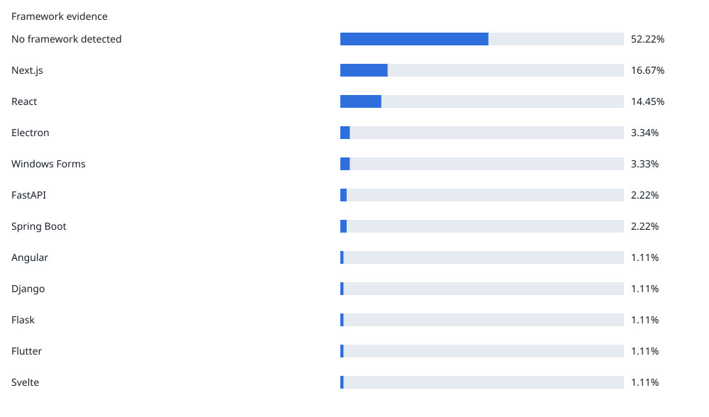
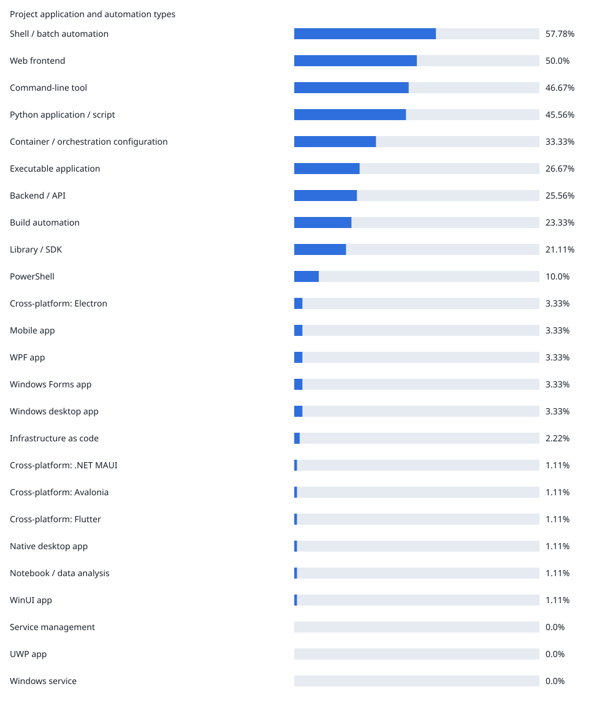
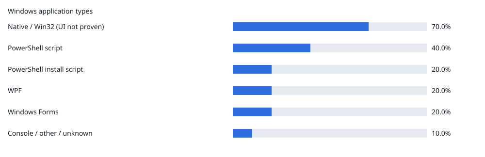
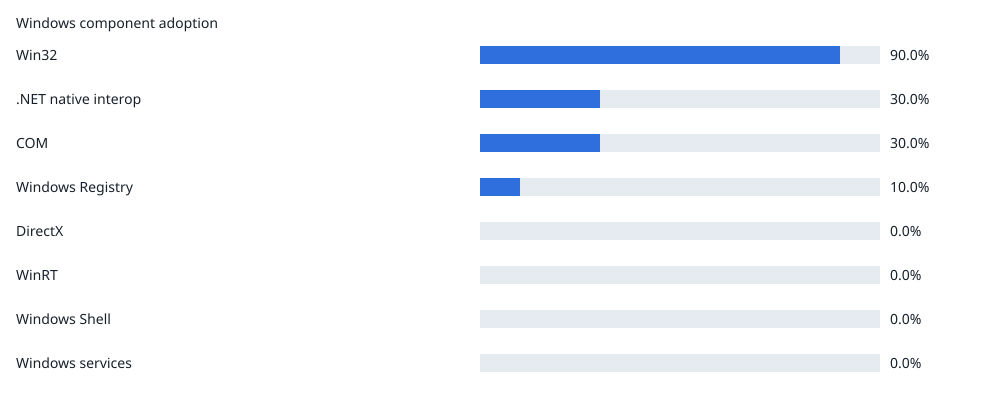
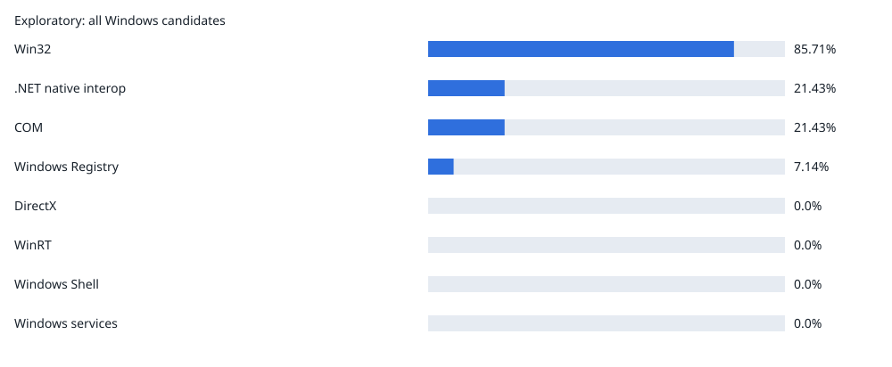

# Windows app discovery — latest report

Activity window (UTC): 2026-10-03T20:00:00Z → 2026-11-02T20:00:00Z
Generated: 2026-11-03T00:35:28Z  
Ruleset: pilot-5; Application Inspector: 1.10.2

Uniform random sample from 344747 public repositories with qualifying human activity.
Seed: 2026-11-02T20:00:00Z; archive hours: 720/720; qualifying events: 987512; deleted/private replacements: 7.
95% Wilson confidence intervals; worst-case margin for complete scans: ±10.33 percentage points.

| Metric | Repositories |
| --- | ---: |
| Sampled | 100 |
| Complete scans | 90 |
| Partial | 8 |
| Failed | 1 |
| No eligible source | 1 |
| Windows candidates (subset of complete scans) | 14 |
| Windows applications (subset of complete scans) | 10 |

## Exclusive repository OS groups

| Category | Repositories | Share |
| --- | ---: | ---: |
| Cross-OS | 10 / 100 | 10.0% |
| Windows | 14 / 100 | 14.0% |
| Others | 76 / 100 | 76.0% |

Deterministic review of pinned public GitHub documentation; no OpenAI API is used. Cross-OS requires explicit documentation of application support for at least two operating systems. CI runners, languages, frameworks, browser access, and inferred portability do not qualify. The remaining repositories are Windows when a complete source scan detects a Windows signal, and Others otherwise. Cross-OS takes precedence; the three groups are mutually exclusive and use the full sample denominator, including ambiguous and undocumented repositories. Windows means a detected signal, not proven Windows-only support. Others means neither cross-OS support nor a qualifying Windows signal demonstrated. Static review, not runtime testing.

## Primary programming languages and their target platforms

GitHub's primary language per repository. The last column splits each language's repositories by primary target platform (an explicit OS target wins, several OS targets = Multiple OS, otherwise the most specific environment; generic runtimes/scripts come last), so each language's platform shares add up to 100%.

Each repository belongs to one category; shares total 100% across the 90 complete scans only. Partial, failed, and no-eligible-source repositories are excluded.

| Category | Count / denominator | Share | CI | Target platform distribution |
| --- | ---: | ---: | --- | --- |
| TypeScript | 23 / 90 | 25.56% | 17.67–35.44% | Web: 78.26%, Windows: 13.04%, Multiple OS \(incl. Windows\): 4.35%, Node.js tooling/runtime \(OS unspecified\): 4.35% |
| Python | 19 / 90 | 21.11% | 13.95–30.63% | Web: 36.84%, Python runtime \(OS unspecified\): 26.31%, Containers / Kubernetes: 10.53%, Linux: 10.53%, Server / backend: 10.53%, Windows: 5.26% |
| Rust | 11 / 90 | 12.22% | 6.96–20.57% | Linux: 27.28%, Multiple OS \(incl. Windows\): 18.18%, Native code \(OS unspecified\): 18.18%, WebAssembly: 18.18%, Web: 9.09%, Windows: 9.09% |
| JavaScript | 10 / 90 | 11.11% | 6.15–19.26% | Web: 60.0%, Node.js tooling/runtime \(OS unspecified\): 20.0%, Android: 10.0%, Linux: 10.0% |
| C# | 5 / 90 | 5.56% | 2.4–12.35% | Web: 40.0%, Windows: 40.0%, Multiple OS \(incl. Windows\): 20.0% |
| Go | 4 / 90 | 4.45% | 1.74–10.88% | Containers / Kubernetes: 50.0%, Web: 25.0%, Windows: 25.0% |
| Java | 4 / 90 | 4.45% | 1.74–10.88% | Windows: 100.0% |
| HTML | 3 / 90 | 3.33% | 1.14–9.35% | Web: 100.0% |
| C++ | 2 / 90 | 2.22% | 0.61–7.74% | Web: 50.0%, Windows: 50.0% |
| Kotlin | 2 / 90 | 2.22% | 0.61–7.74% | Android: 100.0% |
| C | 1 / 90 | 1.11% | 0.2–6.03% | Shell / automation \(OS unspecified\): 100.0% |
| Jupyter Notebook | 1 / 90 | 1.11% | 0.2–6.03% | Python runtime \(OS unspecified\): 100.0% |
| PHP | 1 / 90 | 1.11% | 0.2–6.03% | Web: 100.0% |
| PowerShell | 1 / 90 | 1.11% | 0.2–6.03% | Windows: 100.0% |
| SCSS | 1 / 90 | 1.11% | 0.2–6.03% | Web: 100.0% |
| Shell | 1 / 90 | 1.11% | 0.2–6.03% | Shell / automation \(OS unspecified\): 100.0% |
| Unknown | 1 / 90 | 1.11% | 0.2–6.03% | Unknown: 100.0% |

## Framework evidence

Most specific detected framework per repository (e.g. Next.js before React).

Each repository belongs to one category; shares total 100% across the 90 complete scans only. Partial, failed, and no-eligible-source repositories are excluded.

| Category | Count / denominator | Share | CI |
| --- | ---: | ---: | --- |
| No framework detected | 47 / 90 | 52.22% | 42.02–62.24% |
| Next.js | 15 / 90 | 16.67% | 10.37–25.69% |
| React | 13 / 90 | 14.45% | 8.64–23.16% |
| Electron | 3 / 90 | 3.34% | 1.14–9.35% |
| Windows Forms | 3 / 90 | 3.33% | 1.14–9.35% |
| FastAPI | 2 / 90 | 2.22% | 0.61–7.74% |
| Spring Boot | 2 / 90 | 2.22% | 0.61–7.74% |
| Angular | 1 / 90 | 1.11% | 0.2–6.03% |
| Django | 1 / 90 | 1.11% | 0.2–6.03% |
| Flask | 1 / 90 | 1.11% | 0.2–6.03% |
| Flutter | 1 / 90 | 1.11% | 0.2–6.03% |
| Svelte | 1 / 90 | 1.11% | 0.2–6.03% |

## Project application and automation types

Share of complete repository scans with collected project findings, including libraries/tools and non-Windows PowerShell. Each repository counts once per category across its projects. Categories overlap: Windows desktop app includes Windows Forms, WPF, WinUI, and UWP; shares need not sum to 100%. Older inventories without project findings are excluded. Types are identified from source patterns and project metadata, not inferred from OS or language. Repositories without sufficient type evidence remain in the denominator and are reported in the classification coverage note, not as application types. Static indicators do not prove executable or runtime behavior.

| Category | Count / denominator | Share | CI |
| --- | ---: | ---: | --- |
| Shell / batch automation | 52 / 90 | 57.78% | 47.46–67.46% |
| Web frontend | 45 / 90 | 50.0% | 39.88–60.12% |
| Command-line tool | 42 / 90 | 46.67% | 36.71–56.9% |
| Python application / script | 41 / 90 | 45.56% | 35.66–55.82% |
| Container / orchestration configuration | 30 / 90 | 33.33% | 24.45–43.58% |
| Executable application | 24 / 90 | 26.67% | 18.62–36.62% |
| Backend / API | 23 / 90 | 25.56% | 17.67–35.44% |
| Build automation | 21 / 90 | 23.33% | 15.8–33.05% |
| Library / SDK | 19 / 90 | 21.11% | 13.95–30.63% |
| PowerShell | 9 / 90 | 10.0% | 5.35–17.92% |
| Cross-platform: Electron | 3 / 90 | 3.33% | 1.14–9.35% |
| Mobile app | 3 / 90 | 3.33% | 1.14–9.35% |
| WPF app | 3 / 90 | 3.33% | 1.14–9.35% |
| Windows Forms app | 3 / 90 | 3.33% | 1.14–9.35% |
| Windows desktop app | 3 / 90 | 3.33% | 1.14–9.35% |
| Infrastructure as code | 2 / 90 | 2.22% | 0.61–7.74% |
| Cross-platform: .NET MAUI | 1 / 90 | 1.11% | 0.2–6.03% |
| Cross-platform: Avalonia | 1 / 90 | 1.11% | 0.2–6.03% |
| Cross-platform: Flutter | 1 / 90 | 1.11% | 0.2–6.03% |
| Native desktop app | 1 / 90 | 1.11% | 0.2–6.03% |
| Notebook / data analysis | 1 / 90 | 1.11% | 0.2–6.03% |
| WinUI app | 1 / 90 | 1.11% | 0.2–6.03% |
| Service management | 0 / 90 | 0.0% | 0.0–4.09% |
| UWP app | 0 / 90 | 0.0% | 0.0–4.09% |
| Windows service | 0 / 90 | 0.0% | 0.0–4.09% |

Classification coverage: 3 repositories have insufficient application-type evidence in the scanned source. They remain in the denominator but are not assigned an application type.

## Windows application types

Complete Windows application scans; types can overlap.

| Category | Count / denominator | Share | CI |
| --- | ---: | ---: | --- |
| Native / Win32 \(UI not proven\) | 7 / 10 | 70.0% | 39.68–89.22% |
| PowerShell script | 4 / 10 | 40.0% | 16.82–68.73% |
| PowerShell install script | 2 / 10 | 20.0% | 5.67–50.98% |
| WPF | 2 / 10 | 20.0% | 5.67–50.98% |
| Windows Forms | 2 / 10 | 20.0% | 5.67–50.98% |
| Console / other / unknown | 1 / 10 | 10.0% | 1.79–40.42% |

## Windows component adoption

Complete Windows application scans; components overlap.

| Category | Count / denominator | Share | CI |
| --- | ---: | ---: | --- |
| Win32 | 9 / 10 | 90.0% | 59.58–98.21% |
| .NET native interop | 3 / 10 | 30.0% | 10.78–60.32% |
| COM | 3 / 10 | 30.0% | 10.78–60.32% |
| Windows Registry | 1 / 10 | 10.0% | 1.79–40.42% |
| DirectX | 0 / 10 | 0.0% | 0.0–27.75% |
| WinRT | 0 / 10 | 0.0% | 0.0–27.75% |
| Windows Shell | 0 / 10 | 0.0% | 0.0–27.75% |
| Windows services | 0 / 10 | 0.0% | 0.0–27.75% |

## Windows CI by primary language

Complete scans whose CI configuration (GitHub Actions, AppVeyor, Azure Pipelines, GitLab CI, CircleCI) references a Windows runner or GOOS=windows. Shows intent to build/test on Windows, not run results; dynamic matrices and external CI are not detected. Not an application metric.

| Category | Count / denominator | Share | CI |
| --- | ---: | ---: | --- |
| TypeScript | 2 / 23 | 8.7% | 2.42–26.8% |
| Python | 3 / 19 | 15.79% | 5.52–37.57% |
| Rust | 3 / 11 | 27.27% | 9.75–56.56% |
| JavaScript | 3 / 10 | 30.0% | 10.78–60.32% |
| C# | 3 / 5 | 60.0% | 23.07–88.24% |
| Go | 2 / 4 | 50.0% | 15.0–85.0% |
| Java | 0 / 4 | 0.0% | 0.0–48.99% |
| HTML | 0 / 3 | 0.0% | 0.0–56.15% |
| C++ | 0 / 2 | 0.0% | 0.0–65.76% |
| Kotlin | 0 / 2 | 0.0% | 0.0–65.76% |
| C | 0 / 1 | 0.0% | 0.0–79.35% |
| Jupyter Notebook | 0 / 1 | 0.0% | 0.0–79.35% |
| PHP | 0 / 1 | 0.0% | 0.0–79.35% |
| PowerShell | 1 / 1 | 100.0% | 20.65–100.0% |
| SCSS | 0 / 1 | 0.0% | 0.0–79.35% |
| Shell | 0 / 1 | 0.0% | 0.0–79.35% |
| Unknown | 0 / 1 | 0.0% | 0.0–79.35% |

## Exploratory: all Windows candidates

Includes libraries/tools; not an application metric.

| Category | Count / denominator | Share | CI |
| --- | ---: | ---: | --- |
| Win32 | 12 / 14 | 85.71% | 60.06–95.99% |
| .NET native interop | 3 / 14 | 21.43% | 7.57–47.59% |
| COM | 3 / 14 | 21.43% | 7.57–47.59% |
| Windows Registry | 1 / 14 | 7.14% | 1.27–31.47% |
| DirectX | 0 / 14 | 0.0% | 0.0–21.53% |
| WinRT | 0 / 14 | 0.0% | 0.0–21.53% |
| Windows Shell | 0 / 14 | 0.0% | 0.0–21.53% |
| Windows services | 0 / 14 | 0.0% | 0.0–21.53% |

## Sampled repositories

| Repository | Scan | Language | Platform | Framework | Windows app types | Components |
| --- | --- | --- | --- | --- | --- | --- |
| OSInside/kiwi | success | Python | Linux | No framework detected |  |  |
| PenguinMod/PenguinMod-ExtensionsGallery | partial | JavaScript | Web | Svelte |  |  |
| TandemVector-Labs/.github | success | Python | Python runtime \(OS unspecified\) | No framework detected |  |  |
| anotherpanacea-eng/apodictic-tauri | success | JavaScript | Linux | No framework detected |  |  |
| ai-ecoverse/slicc-agent | success | TypeScript | Web | No framework detected |  |  |
| chewtoo22-rgb/SoundMesh | success | Kotlin | Android | No framework detected |  |  |
| vegekyd-sys/v-nightshift | success | JavaScript | Web | React |  |  |
| tnt007tarun/StreamCast | success | JavaScript | Web | No framework detected |  |  |
| mathildekw/mathildekw | success | HTML | Web | No framework detected |  |  |
| 0ladymt/mt-pack-organizer-releases | success | PowerShell | Windows | Windows Forms | PowerShell script, WPF, Windows Forms | .NET native interop, COM, Win32 |
| jiya-m/capstone | success | Python | Python runtime \(OS unspecified\) | No framework detected |  |  |
| iFixit/govinor | success | TypeScript | Web | React |  |  |
| mongodb-js/compass | success | TypeScript | Web | Electron | Cross-platform: Electron |  |
| felipeaugusantos/erpzetech | success | TypeScript | Web | React |  |  |
| miszyszka/Epcido-Terminal | success | TypeScript | Web | React |  |  |
| sandeepkumarkrprabhu/ZYRAHRM-Backend | success | C# | Web | No framework detected |  |  |
| sebrandon1/imagecertinfo-operator | success | Go | Containers / Kubernetes | No framework detected |  |  |
| karagemop466-tech/LOLHOTSPAWN2 | success | Python | Web | No framework detected |  |  |
| developerz-ai/multi-ai-router | success | TypeScript | Windows | No framework detected | Console / other / unknown |  |
| rafs2006/optimus | success | Python | Containers / Kubernetes | No framework detected |  |  |
| charmbracelet/vhs | success | Go | Containers / Kubernetes | No framework detected |  |  |
| solaranoir/pocketsat-testlab | success | Python | Python runtime \(OS unspecified\) | No framework detected |  |  |
| baekenough/oh-my-customcode | success | TypeScript | Windows | Svelte | Native / Win32 \(UI not proven\) | Win32 |
| pingvis/Nida-Windows | success | Rust | Multiple OS \(incl. Windows\) | Next.js | Native / Win32 \(UI not proven\), PowerShell install script, PowerShell module, PowerShell script | .NET native interop, COM, DirectX, Win32, WinRT |
| robot-pesg/NavSR | success | Unknown | Unknown | No framework detected |  |  |
| rckearns/sitescan-frontend | success | JavaScript | Web | React |  |  |
| manwar/perlweeklychallenge-club | partial | Perl | Multiple OS \(incl. Windows\) | No framework detected | Native / Win32 \(UI not proven\) | Win32 |
| justinhunt/moodle-repository\_cloudpoodll | success | PHP | Web | No framework detected |  |  |
| houraniiiii/Renulus | partial | Python | Multiple OS \(incl. Windows\) | Windows Forms | Cross-platform: Electron, PowerShell install script, PowerShell script, Windows Forms | .NET native interop, Win32, WinRT |
| approoveapp/approove | success | TypeScript | Web | Next.js |  |  |
| hockeybuggy/hockeybuggy.com | success | Rust | Web | No framework detected |  |  |
| Carlos-39/multimodal\_presenter | success | TypeScript | Web | Next.js |  |  |
| Quimia-br/quimia-web-crud | success | Java | Windows | Spring Boot | Native / Win32 \(UI not proven\) | Win32 |
| julienld/ha-mcp-native | success | Python | Windows | No framework detected | Native / Win32 \(UI not proven\), PowerShell install script, PowerShell script | Win32 |
| aboodmoh724-svg/halqa-followup | success | TypeScript | Web | Next.js |  |  |
| Bambale0/banano\_kling | success | Python | Web | Next.js |  |  |
| KrzysztofMarciniak/scjson | success | C | Shell / automation \(OS unspecified\) | No framework detected |  |  |
| Leonn190/PokeTactics | partial | TypeScript | Python runtime \(OS unspecified\) | No framework detected |  |  |
| mlengse/orthos | success | Python | Python runtime \(OS unspecified\) | No framework detected |  |  |
| GeneralKnowledge/Good-Dog-Book | success | Shell | Shell / automation \(OS unspecified\) | No framework detected |  |  |
| CharitonMedia/Tremelay | success | Go | Web | Next.js | PowerShell script |  |
| duongcongcao-0312/duannhom5-main | success | JavaScript | Web | No framework detected |  |  |
| Azure/azure-cli-extensions | partial | Python | Cloud / infrastructure | No framework detected | PowerShell script |  |
| ThreeMonth03/Conjugate-Gradient-Method-library | success | Python | Containers / Kubernetes | No framework detected |  |  |
| OpenVTC/verifiable-git-infrastructure | success | Rust | Linux | No framework detected |  |  |
| ajare/vulkan-poly-pusher | success | C++ | Windows | No framework detected | Native / Win32 \(UI not proven\) | COM, Win32 |
| Stiftelsen-Hulen/hulen.no | success | TypeScript | Web | Next.js |  |  |
| Gloria-GK-406/DNF-JP-86-Server | success | C# | Windows | React | Native / Win32 \(UI not proven\), PowerShell script | .NET native interop, Win32 |
| PostHog/trino | success | Java | Windows | React | Native / Win32 \(UI not proven\) | Win32 |
| xiajiajun516/dsh-config-manager | success | TypeScript | Windows | React | Native / Win32 \(UI not proven\) | .NET native interop, COM, Win32 |
| deepmsg/deepmsg | success | Rust | Windows | No framework detected | Native / Win32 \(UI not proven\) | Win32 |
| manh-vv/docb | success | TypeScript | Web | React |  |  |
| ClarionLive/multiterminal | success | C# | Windows | Windows Forms | PowerShell install script, PowerShell script, WPF, Windows Forms | .NET native interop, Win32, Windows Registry |
| michael-bachmann/lineitem | success | TypeScript | Web | React |  |  |
| argmend/argmend | success | Rust | Native code \(OS unspecified\) | No framework detected |  |  |
| Ndegwa4943/Merstat-FrontEnd | success | HTML | Web | No framework detected |  |  |
| Rufics/fpv-radio-map | success | C++ | Web | Angular |  |  |
| HHS/simpler-grants-gov | success | Python | Web | Next.js |  |  |
| robert-koch-institut/mex-backend | success | Python | Server / backend | FastAPI |  |  |
| EFForg/privacybadger-website | success | SCSS | Web | No framework detected |  |  |
| DanielAmah/ai-dev-quiz-app | success | TypeScript | Web | React |  |  |
| Project-Colony/Xion | success | Rust | Multiple OS \(incl. Windows\) | No framework detected | Console / other / unknown |  |
| deankim77/jsolution-ai-plm-postgres | success | TypeScript | Web | Next.js |  |  |
| johnhenry/workflows | success | JavaScript | Node.js tooling/runtime \(OS unspecified\) | No framework detected |  |  |
| Calhooon/bsv-overlay-cloudflare | success | Rust | WebAssembly | Next.js |  |  |
| Austin-Ellefson/Wargame | not\_applicable | Unknown | Unknown | No framework detected |  |  |
| Statsify/statsify | success | TypeScript | Multiple OS \(incl. Windows\) | Next.js | Native / Win32 \(UI not proven\) | Win32 |
| amitmohapatra/agent-memory-service | success | Python | Web | Next.js |  |  |
| guruoshan/Paid-Due | success | Kotlin | Android | No framework detected |  |  |
| TurnGui/catchlog-api | success | C# | Web | No framework detected |  |  |
| PennyLaneAI/demos | failed |  |  |  |  |  |
| xex-ken-xex/ai-gm-bridge | success | Python | Web | No framework detected |  |  |
| flytiger-eco/TransformerEngine-for-sail | success | Python | Linux | No framework detected |  |  |
| culturesofknowledge/site-front-2 | success | JavaScript | Web | Flask |  |  |
| anthropics/prompt-eng-interactive-tutorial | success | Jupyter Notebook | Python runtime \(OS unspecified\) | No framework detected |  |  |
| richardpowellus/invisible\_playwright\_mcp | success | Python | Web | No framework detected |  |  |
| misospace/pr-reviewer-action | success | TypeScript | Web | No framework detected |  |  |
| ejb1123/teleport | success | Rust | Linux | No framework detected |  |  |
| protoLabsAI/protobanana-plugin | success | Python | Web | React |  |  |
| pontago/otenki-live | success | TypeScript | Web | Next.js |  |  |
| eepstein201/jev-mcp | success | Python | Server / backend | FastAPI |  |  |
| MichaelUserBro/SeaBattle | partial | C++ | Unknown | No framework detected |  |  |
| twhitelow1/anthony-insurance-services-forms | success | TypeScript | Web | Next.js |  |  |
| stavroskasidis/codalus-ide | success | C# | Multiple OS \(incl. Windows\) | Windows Forms | Cross-platform: .NET MAUI, Cross-platform: Avalonia, PowerShell script, WPF, WinUI / Windows App SDK, Windows Forms | .NET native interop, COM, DirectX, Win32, Windows Registry |
| anza-xyz/xtask | success | Rust | Native code \(OS unspecified\) | No framework detected |  |  |
| percona/percona-server | partial | C++ | Multiple OS \(incl. Windows\) | No framework detected | Native / Win32 \(UI not proven\) | COM, Win32 |
| BestTeam-MosipDecode/face-liveness-pad | success | Java | Windows | Spring Boot | Native / Win32 \(UI not proven\), PowerShell script | Win32 |
| Mitchk1995/dragonbound | success | TypeScript | Web | Electron | Cross-platform: Electron |  |
| zksecurity/wasmati | success | TypeScript | Node.js tooling/runtime \(OS unspecified\) | No framework detected |  |  |
| RestartDK/dotfiles | success | TypeScript | Web | No framework detected |  |  |
| eom-tae-in/ticket-on | success | Java | Windows | Next.js | Native / Win32 \(UI not proven\) | Win32 |
| nextcloud/logreader | partial | JavaScript | Windows | Vue | Native / Win32 \(UI not proven\) | Win32 |
| farhananwarghumman/TippSend | success | HTML | Web | No framework detected |  |  |
| rootscripts/riff | success | JavaScript | Web | Electron | Cross-platform: Electron |  |
| thiagodmont/greeg | success | Rust | WebAssembly | Django |  |  |
| Prekzursil/fractal-darkroom | success | Python | Python runtime \(OS unspecified\) | No framework detected |  |  |
| konstelasi/StarDustDocs | success | JavaScript | Node.js tooling/runtime \(OS unspecified\) | No framework detected |  |  |
| runkids/skillshare | success | Go | Windows | React | Native / Win32 \(UI not proven\), PowerShell install script, PowerShell script | .NET native interop, Win32 |
| basher83/tailnet-microservices | success | Rust | Linux | No framework detected |  |  |
| faizal97/realm-of-loner | success | JavaScript | Android | Flutter | Cross-platform: Flutter |  |

## Windows-container compatibility and containerization potential

Static base-image indicators from scanned Dockerfiles and Containerfiles; no build or runtime test.

Among complete Windows-targeted scans, repositories with container/orchestration configuration or Dockerfile/Containerfile base images are excluded. Remaining project-type and Windows-component indicators are heuristic screening evidence, not a test of Windows-container support.

The two assessment scopes overlap; their counts must not be added together.

| Scope | Assessment | Repositories |
| --- | --- | ---: |
| Base-image evidence | Windows base image configured | 0 |
| Base-image evidence | Linux base image configured | 12 |
| Base-image evidence | Mixed or ambiguous base images | 14 |
| Base-image evidence | No container base-image evidence | 64 |
| Base-image evidence | Incomplete source scan | 10 |
| Containerization potential | Potentially suitable; validate with a build/run | 3 |
| Containerization potential | Conditional; dependencies or project type need review | 3 |
| Containerization potential | Poor fit for standard Windows Server containers | 4 |
| Containerization potential | Insufficient project evidence | 0 |
| Containerization potential | Excluded: container/orchestration evidence detected | 8 |
| Containerization potential | Excluded: no Windows target detected | 72 |
| Containerization potential | Not assessed: incomplete scan | 10 |

These are source-level indicators, not proof of build or runtime compatibility. No detected Dockerfile is not proof of incompatibility.

| Repository | Existing container evidence | Containerization potential | Source evidence |
| --- | --- | --- | --- |
| [0ladymt/mt-pack-organizer-releases](https://github.com/0ladymt/mt-pack-organizer-releases) | No Dockerfile or Containerfile base image was found in the scanned source; this does not establish incompatibility. | Detected desktop UI or graphics dependency is a poor fit for standard Windows Server containers: WPF, Windows Forms. | .NET native interop \(src/MT\_Pack\_Organizer.ps1:82\), .NET native interop \(src/MT\_Pack\_Organizer.ps1:4164\), .NET native interop \(src/MT\_Pack\_Organizer.ps1:4165\), .NET native interop \(src/MT\_Pack\_Organizer.ps1:4189\), .NET native interop \(src/MT\_Pack\_Organizer\_0.9.16.ps1:2697\), .NET native interop \(src/MT\_Pack\_Organizer\_0.9.16.ps1:2698\), COM \(src/MT\_Pack\_Organizer.ps1:4175\), PowerShell script \(patches/current.ps1:1\), PowerShell script \(src/MT\_Pack\_Organizer.ps1:1\), PowerShell script \(src/MT\_Pack\_Organizer\_0.9.16.ps1:1\), Python application / script \(tools/generate\_butterfly\_flight.py:101\), WPF \(src/MT\_Pack\_Organizer.ps1:908\), WPF \(src/MT\_Pack\_Organizer\_0.9.16.ps1:760\), Win32 \(src/MT\_Pack\_Organizer.ps1:82\), Win32 \(src/MT\_Pack\_Organizer.ps1:4164\), Win32 \(src/MT\_Pack\_Organizer\_0.9.16.ps1:2697\), Windows Forms \(src/MT\_Pack\_Organizer.ps1:2\), Windows Forms \(src/MT\_Pack\_Organizer.ps1:2771\), Windows Forms \(src/MT\_Pack\_Organizer.ps1:2780\), Windows Forms \(src/MT\_Pack\_Organizer.ps1:3112\), Windows Forms \(src/MT\_Pack\_Organizer.ps1:3468\), Windows Forms \(src/MT\_Pack\_Organizer.ps1:3486\), Windows Forms \(src/MT\_Pack\_Organizer.ps1:3490\), Windows Forms \(src/MT\_Pack\_Organizer.ps1:3690\), Windows Forms \(src/MT\_Pack\_Organizer\_0.9.16.ps1:2\), Windows Forms \(src/MT\_Pack\_Organizer\_0.9.16.ps1:1783\), Windows Forms \(src/MT\_Pack\_Organizer\_0.9.16.ps1:1977\), Windows Forms \(src/MT\_Pack\_Organizer\_0.9.16.ps1:2307\) |
| [mongodb-js/compass](https://github.com/mongodb-js/compass) | Explicit Linux container base image configured; Windows-container compatibility is not established. | No Windows target was detected. | node:$\{NODE\_JS\_VERSION\}-bookworm \(linux; .evergreen/connectivity-tests/Dockerfile:4\) |
| [sebrandon1/imagecertinfo-operator](https://github.com/sebrandon1/imagecertinfo-operator) | Container base-image evidence is mixed or ambiguous; Windows-container compatibility is undetermined. | No Windows target was detected. | golang:1.27.3 \(unknown; Dockerfile:2\), gcr.io/distroless/static:nonroot \(linux; Dockerfile:28\) |
| [developerz-ai/multi-ai-router](https://github.com/developerz-ai/multi-ai-router) | Container base-image evidence is mixed or ambiguous; Windows-container compatibility is undetermined. | Container or orchestration configuration was detected; excluded from the not-yet-containerized assessment. | oven/bun:1.4.4@sha256:1d22548f177f4ff38e0c15baa3c2c46c6c2060ba2d1bc573bb4720b407548f1d \(unknown; Dockerfile:41\), oven/bun:1.4.4-slim@sha256:1846adf22496bd711036aae8be147e57bdebbaea2e5264e3e0b5af1db187d9a4 \(linux; Dockerfile:161\) |
| [rafs2006/optimus](https://github.com/rafs2006/optimus) | Explicit Linux container base image configured; Windows-container compatibility is not established. | No Windows target was detected. | ghcr.io/astral-sh/uv:0.9.9-$\{UV\_PYTHON\_TAG\}-bookworm-slim \(linux; Dockerfile:17\), python:$\{PYTHON\_VERSION\}-slim-bookworm \(linux; Dockerfile:46\) |
| [charmbracelet/vhs](https://github.com/charmbracelet/vhs) | Explicit Linux container base image configured; Windows-container compatibility is not established. | No Windows target was detected. | tsl0922/ttyd:alpine \(linux; Dockerfile:1\), alpine:latest \(linux; Dockerfile:2\), debian:stable-slim \(linux; Dockerfile:22\) |
| [baekenough/oh-my-customcode](https://github.com/baekenough/oh-my-customcode) | Explicit Linux container base image configured; Windows-container compatibility is not established. | Container or orchestration configuration was detected; excluded from the not-yet-containerized assessment. | alpine:3.21 \(linux; infra/hada-scout/Dockerfile:5\) |
| [pingvis/Nida-Windows](https://github.com/pingvis/Nida-Windows) | No Dockerfile or Containerfile base image was found in the scanned source; this does not establish incompatibility. | Detected desktop UI or graphics dependency is a poor fit for standard Windows Server containers: Native desktop app. | .NET native interop \(src/internal/presentation/windows-powerpoint.ps1:302\), .NET native interop \(src/internal/presentation/windows-powerpoint.ps1:303\), .NET native interop \(src/internal/presentation/windows-powerpoint.ps1:304\), .NET native interop \(src/internal/presentation/windows-powerpoint.ps1:305\), .NET native interop \(src/internal/presentation/windows-powerpoint.ps1:335\), .NET native interop \(src/internal/presentation/windows-powerpoint.ps1:336\), .NET native interop \(src/internal/presentation/windows-powerpoint.ps1:337\), .NET native interop \(src/internal/presentation/windows-powerpoint.ps1:338\), .NET native interop \(src/internal/presentation/windows-powerpoint.ps1:339\), .NET native interop \(src/internal/presentation/windows-powerpoint.ps1:340\), .NET native interop \(src/internal/presentation/windows-powerpoint.ps1:341\), .NET native interop \(src/internal/presentation/windows-powerpoint.ps1:342\), Build automation \(browser/cef/CMakeLists.txt:1\), COM \(src/internal/audio/app\_sound/windows.rs:57\), COM \(src/internal/audio/app\_sound/windows.rs:65\), COM \(src/internal/decklink/platform.hpp:24\), COM \(src/internal/decklink/platform.hpp:27\), COM \(src/internal/decklink/platform.hpp:58\), COM \(src/internal/decklink/platform.hpp:66\), Command-line tool \(build.rs:67\), Command-line tool \(scripts/ci/benchmark-browser-host.py:17\), Command-line tool \(scripts/ci/benchmark-windows-startup.py:112\), Command-line tool \(scripts/ci/bundle-macos-libs.py:759\), Command-line tool \(scripts/ci/extract-windows-cef.py:46\), Command-line tool \(scripts/ci/publish-windows-release.py:132\), Command-line tool \(scripts/ci/setup-linux-ffmpeg.py:104\), Command-line tool \(scripts/ci/test-browser-host.py:264\), Command-line tool \(scripts/ci/windows-notices.py:17\), Command-line tool \(src/app/keep\_awake.rs:107\), Command-line tool \(src/app/mod.rs:60\), Command-line tool \(src/app/state/outputs.rs:1550\), Command-line tool \(src/app/state/rundown.rs:1974\), Command-line tool \(src/app/state/ui\_motion.rs:351\), Command-line tool \(src/app/workspace.rs:1787\), Command-line tool \(src/internal/audio/app\_sound.rs:655\), Command-line tool \(src/internal/cli\_install.rs:100\), Command-line tool \(src/internal/clicker/macos.rs:359\), Command-line tool \(src/internal/html/cef\_backend.rs:122\), Command-line tool \(src/internal/presentation/powerpoint.rs:405\), Command-line tool \(src/internal/presentation/windows.rs:137\), Command-line tool \(src/internal/record/mod.rs:469\), Command-line tool \(src/internal/renderer/nv12.rs:311\), Command-line tool \(src/internal/renderer/subprocess.rs:504\), Command-line tool \(src/internal/stream/mod.rs:964\), Command-line tool \(src/internal/streaming/fanout.rs:903\), Command-line tool \(src/internal/streaming/mod.rs:73\), Command-line tool \(src/internal/video/mod.rs:2469\), Command-line tool \(src/internal/video/sound\_only.rs:140\), Command-line tool \(src/main.rs:1\), Command-line tool \(src/testing.rs:63\), Command-line tool \(src/usecases/ui/runner/mod.rs:2737\), Command-line tool \(tools/stream-bitrate-probe/rust.rs:78\), DirectX \(src/internal/screen\_capture/platform/windows.rs:539\), Executable application \(build.rs:6\), Executable application \(scripts/ci/benchmark-browser-conversion.rs:6\), Executable application \(scripts/ci/benchmark-capture-resample.rs:4\), Executable application \(src/internal/mixer/mod.rs:891\), Executable application \(src/main.rs:107\), Executable application \(tools/audio-compressor-probe/src/main.rs:252\), Executable application \(tools/stream-bitrate-probe/rust.rs:15\), Library / SDK \(Cargo.toml:8\), Library / SDK \(browser/cef/CMakeLists.txt:15\), Library / SDK \(browser/protocol/Cargo.toml:9\), Native desktop app \(src/internal/renderer/capture\_exclusion.rs:210\), Native desktop app \(src/internal/screen\_capture/platform/windows.rs:864\), Next.js \(src/internal/rundown/tests.rs:643\), PowerShell install script \(scripts/ci/setup-inno.ps1:1\), PowerShell install script \(scripts/ci/setup-windows-build.ps1:1\), PowerShell install script \(scripts/ci/setup-windows-cef.ps1:1\), PowerShell module \(scripts/ci/windows-package.psm1:1\), PowerShell script \(scripts/ci/build-windows-browser.ps1:1\), PowerShell script \(scripts/ci/build-windows-installer.ps1:1\), PowerShell script \(scripts/ci/build-windows.ps1:1\), PowerShell script \(scripts/ci/setup-inno.ps1:1\), PowerShell script \(scripts/ci/setup-windows-build.ps1:1\), PowerShell script \(scripts/ci/setup-windows-cef.ps1:1\), PowerShell script \(scripts/ci/test-windows-cef-cache.ps1:1\), PowerShell script \(scripts/ci/test-windows-installer.ps1:1\), PowerShell script \(scripts/ci/test-windows-package-helpers.ps1:1\), PowerShell script \(scripts/ci/test-windows-package.ps1:1\), PowerShell script \(scripts/ci/test-windows-powerpoint.ps1:1\), PowerShell script \(scripts/make-video-fixtures.ps1:1\), PowerShell script \(scripts/measure-audio-eq.ps1:1\), PowerShell script \(scripts/measure-video.ps1:1\), PowerShell script \(scripts/run-windows-browser-debug.ps1:1\), PowerShell script \(src/internal/presentation/windows-powerpoint.ps1:1\), PowerShell script \(tools/stream-bitrate-probe/quality.ps1:1\), PowerShell script \(tools/stream-bitrate-probe/run.ps1:1\), Python application / script \(scripts/ci/benchmark-browser-host.py:66\), Python application / script \(scripts/ci/benchmark-windows-startup.py:111\), Python application / script \(scripts/ci/bundle-macos-libs.py:784\), Python application / script \(scripts/ci/component-changes.py:82\), Python application / script \(scripts/ci/extract-windows-cef.py:45\), Python application / script \(scripts/ci/publish-windows-release.py:156\), Python application / script \(scripts/ci/setup-linux-ffmpeg.py:138\), Python application / script \(scripts/ci/test-browser-host-expect.py:52\), Python application / script \(scripts/ci/test-browser-host.py:263\), Python application / script \(scripts/ci/test-component-changes.py:71\), Python application / script \(scripts/ci/test-publish-windows-release.py:178\), Python application / script \(scripts/ci/test-windows-cef-extraction.py:65\), Python application / script \(scripts/ci/test-windows-startup-benchmark.py:47\), Python application / script \(scripts/ci/windows-notices.py:57\), Python application / script \(scripts/present-trace.py:194\), Shell / batch automation \(scripts/bench-smoke.sh:1\), Shell / batch automation \(scripts/ci/build-ffmpeg-x86\_64.sh:1\), Shell / batch automation \(scripts/ci/build-linux.sh:1\), Shell / batch automation \(scripts/ci/build-macos.sh:1\), Shell / batch automation \(scripts/ci/combine-universal.sh:1\), Shell / batch automation \(scripts/install-cli-linux.sh:1\), Shell / batch automation \(scripts/install-cli-macos.sh:1\), Shell / batch automation \(scripts/main-thread-audit.sh:1\), Shell / batch automation \(scripts/make-local-app.sh:1\), Win32 \(browser/cef/main.cpp:2\), Win32 \(scripts/ci/windows-app-audio-tone.cpp:6\), Win32 \(src/internal/decklink/platform.hpp:9\), Win32 \(src/internal/presentation/windows-powerpoint.ps1:302\), Win32 \(src/internal/presentation/windows-powerpoint.ps1:303\), Win32 \(src/internal/presentation/windows-powerpoint.ps1:304\), Win32 \(src/internal/presentation/windows-powerpoint.ps1:305\), Win32 \(src/internal/presentation/windows-powerpoint.ps1:335\), Win32 \(src/internal/presentation/windows-powerpoint.ps1:336\), Win32 \(src/internal/presentation/windows-powerpoint.ps1:337\), Win32 \(src/internal/presentation/windows-powerpoint.ps1:338\), Win32 \(src/internal/presentation/windows-powerpoint.ps1:339\), Win32 \(src/internal/presentation/windows-powerpoint.ps1:340\), Win32 \(src/internal/presentation/windows-powerpoint.ps1:341\), Win32 \(src/internal/presentation/windows-powerpoint.ps1:342\), Win32 \(src/internal/renderer/capture\_exclusion.rs:210\), Win32 \(src/internal/screen\_capture/platform/windows.rs:864\), WinRT \(src/internal/screen\_capture/platform/windows.rs:56\), WinRT \(src/internal/screen\_capture/platform/windows.rs:59\) |
| [Carlos-39/multimodal\_presenter](https://github.com/Carlos-39/multimodal\_presenter) | Explicit Linux container base image configured; Windows-container compatibility is not established. | No Windows target was detected. | python:3.12-slim \(linux; backend/Dockerfile:14\), python:3.12-slim \(linux; backend/Dockerfile:37\), node:24-slim \(linux; frontend/Dockerfile:12\), node:24-slim \(linux; frontend/Dockerfile:24\), node:24-slim \(linux; frontend/Dockerfile:43\) |
| [Quimia-br/quimia-web-crud](https://github.com/Quimia-br/quimia-web-crud) | Container base-image evidence is mixed or ambiguous; Windows-container compatibility is undetermined. | Container or orchestration configuration was detected; excluded from the not-yet-containerized assessment. | eclipse-temurin:25-jdk \(unknown; Dockerfile:5\), eclipse-temurin:25-jre \(unknown; Dockerfile:18\) |
| [julienld/ha-mcp-native](https://github.com/julienld/ha-mcp-native) | Container base-image evidence is mixed or ambiguous; Windows-container compatibility is undetermined. | Container or orchestration configuration was detected; excluded from the not-yet-containerized assessment. | ghcr.io/astral-sh/uv:0.13.6-python3.13-trixie-slim@sha256:e586c1c65b7071aec78f02c5587c76c5011159cd76b3d6f1255f40e48e850abc \(linux; Dockerfile:11\), $\{PYTHON\_BASE\} \(unknown; Dockerfile:33\), ghcr.io/astral-sh/uv:0.13.6-python3.13-trixie-slim@sha256:e586c1c65b7071aec78f02c5587c76c5011159cd76b3d6f1255f40e48e850abc \(linux; homeassistant-addon-dev/Dockerfile:10\), $\{PYTHON\_BASE\} \(unknown; homeassistant-addon-dev/Dockerfile:32\), $\{PYTHON\_BASE\} \(unknown; homeassistant-addon-webhook-proxy-dev/Dockerfile:9\), public.ecr.aws/docker/library/python:3.13-slim@sha256:3de9a8d7aedbb7984dc18f2dff178a7850f16c1ae7c34ba9d7ecc23d0755e35f \(linux; homeassistant-addon-webhook-proxy/Dockerfile:6\), ghcr.io/astral-sh/uv:0.13.6-python3.13-trixie-slim@sha256:e586c1c65b7071aec78f02c5587c76c5011159cd76b3d6f1255f40e48e850abc \(linux; homeassistant-addon/Dockerfile:11\), $\{PYTHON\_BASE\} \(unknown; homeassistant-addon/Dockerfile:33\) |
| [duongcongcao-0312/duannhom5-main](https://github.com/duongcongcao-0312/duannhom5-main) | Explicit Linux container base image configured; Windows-container compatibility is not established. | No Windows target was detected. | node:20-alpine \(linux; Dockerfile:1\) |
| [ThreeMonth03/Conjugate-Gradient-Method-library](https://github.com/ThreeMonth03/Conjugate-Gradient-Method-library) | Explicit Linux container base image configured; Windows-container compatibility is not established. | No Windows target was detected. | python:3.12-slim-bookworm \(linux; contrib/docker/dockerfile:1\) |
| [OpenVTC/verifiable-git-infrastructure](https://github.com/OpenVTC/verifiable-git-infrastructure) | Explicit Linux container base image configured; Windows-container compatibility is not established. | No Windows target was detected. | rust:1.98-bookworm@sha256:93ce27a88655056a51dbdd8f5f2d7ddc071c7b0070fb288a37b5a285fc83971e \(linux; crates/vgi-bridge/Dockerfile:14\), debian:bookworm-slim@sha256:7c7b2c966bc9ee8cedfeef67e0e279108992c77681fa595db4a9d65c06ccc587 \(linux; crates/vgi-bridge/Dockerfile:24\) |
| [ajare/vulkan-poly-pusher](https://github.com/ajare/vulkan-poly-pusher) | No Dockerfile or Containerfile base image was found in the scanned source; this does not establish incompatibility. | Containerization may be possible, but detected Windows/cross-platform dependencies or application type need validation: COM. | Build automation \(CMakeLists.txt:1\), COM \(mpp-app-support/src/FileDialog.cpp:72\), COM \(mpp-app-support/src/FileDialog.cpp:74\), COM \(mpp-app-support/src/FileDialog.cpp:75\), COM \(mpp-app-support/src/FileDialog.cpp:101\), Library / SDK \(CMakeLists.txt:21\), Shell / batch automation \(program-builder/CopyBin.bat:1\), Win32 \(mpp-app-support/src/DocumentFile.cpp:8\), Win32 \(mpp-app-support/src/FileDialog.cpp:3\), Win32 \(mpp-app-support/src/PackageManifest.cpp:6\), Win32 \(mpp-app-support/src/ZipArchive.cpp:11\), Win32 \(mpp-resource-parsers/src/DocumentWriter.cpp:5\), Win32 \(mpp-resource-parsers/src/FileTextureStream.cpp:2\), Win32 \(mpp/include/mpp/backward.hpp:342\), Win32 \(mpp/src/Mesh.cpp:2\), Win32 \(mpp/src/Model.cpp:5\), Win32 \(mpp/src/Profiler.cpp:9\), Win32 \(mpp/src/Program.cpp:5\), Win32 \(mpp/src/ProgrammaticRenderTextureStream.cpp:2\), Win32 \(mpp/src/ProgrammaticSamplerStream.cpp:2\), Win32 \(mpp/src/ProgrammaticTextureStream.cpp:2\), Win32 \(mpp/src/RenderOutputProcessor.cpp:3\), Win32 \(mpp/src/RenderSystem.cpp:4\), Win32 \(mpp/src/RenderTarget.cpp:4\), Win32 \(mpp/src/Sampler.cpp:4\), Win32 \(mpp/src/SamplerParams.cpp:2\), Win32 \(mpp/src/Screen.cpp:6\), Win32 \(mpp/src/Texture.cpp:4\), Win32 \(mpp/src/TextureData.cpp:2\), Win32 \(mpp/src/TextureParams.cpp:2\), Win32 \(mpp/src/UniformCollection.cpp:2\) |
| [Gloria-GK-406/DNF-JP-86-Server](https://github.com/Gloria-GK-406/DNF-JP-86-Server) | No Dockerfile or Containerfile base image was found in the scanned source; this does not establish incompatibility. | Containerization may be possible, but detected Windows/cross-platform dependencies or application type need validation: .NET native interop, Backend / API, Command-line tool. | .NET native interop \(Server/src/Dfo.Server.Networking/Runtime/TcpServices.cs:191\), Backend / API \(Document/tasks/circus/ProbeHost/ProbeHost.csproj:1\), Backend / API \(Server/src/Dfo.Server.GmWeb/GmAuthenticationEndpoints.cs:20\), Backend / API \(Server/src/Dfo.Server.GmWeb/GmItemEndpoints.cs:17\), Backend / API \(Server/src/Dfo.Server.GmWeb/GmOfficialMailEndpoints.cs:26\), Backend / API \(Server/src/Dfo.Server.GmWeb/GmServerInfoEndpoints.cs:19\), Backend / API \(Server/src/Dfo.Server.GmWeb/GmWebModule.cs:34\), Backend / API \(Server/src/Dfo.Server.HttpApi/HttpApiApplicationExtensions.cs:45\), Command-line tool \(.rks-agent/tasks/party-directory-completion/attempts/spec-003-native-party-directory-runtime/evidence/runtime/directory\_capture\_proxy.py:342\), Command-line tool \(.rks-agent/tasks/party-directory-completion/attempts/spec-003-native-party-directory-runtime/evidence/runtime/directory\_state\_probe.py:748\), Command-line tool \(.rks-agent/tasks/party-directory-completion/attempts/spec-003-native-party-directory-runtime/evidence/runtime/party\_association\_snapshot.py:66\), Command-line tool \(.rks-agent/tasks/party-mode-rules/attempts/spec-001-party-settings-foundation/evidence/probe\_a21\_party\_settings.py:147\), Command-line tool \(.rks-agent/tasks/party-mode-rules/attempts/spec-001-party-settings-foundation/evidence/task04/capture\_proxy.py:299\), Command-line tool \(.rks-agent/tasks/party-mode-rules/attempts/spec-002-normal-party-mode/evidence/task01/capture\_normal\_proxy.py:130\), Command-line tool \(.rks-agent/tasks/party-mode-rules/attempts/spec-002-normal-party-mode/evidence/task01/probe\_normal\_party.py:119\), Command-line tool \(.rks-agent/tasks/party-mode-story-cycle/attempts/spec-001-story-party-mode/evidence/task01/probe\_story\_party.py:188\), Command-line tool \(.rks-agent/tasks/serial-gameplay-executor/attempts/spec-002-protocol-level-cmd/verification/probe-tools/migration-ledger.py:557\), Command-line tool \(Document/SealedTreasure-Research-20261019/protocol/a21\_dump\_inspect.py:75\), Command-line tool \(Document/abyss-research-20261007/evidence/client-scan.py:6\), Command-line tool \(Document/outputs/collection-box-20261019/probe.py:42\), Command-line tool \(Document/outputs/drop-source-analysis-20260923/drop-source-probe.py:17\), Command-line tool \(Document/outputs/experience-client-mapping-20260928/noti0025-disasm.py:11\), Command-line tool \(Document/outputs/illusion-tower-20261003/collect.py:210\), Command-line tool \(Document/outputs/issue-101/capture\_admission.py:146\), Command-line tool \(Document/outputs/issue-101/client/disasm\_a21.py:25\), Command-line tool \(Document/outputs/issue-101/client/read\_admission\_state.py:101\), Command-line tool \(Document/outputs/issue-101/client/xrefs\_a21.py:19\), Command-line tool \(Document/outputs/issue-101/fatigue/fatigue\_static\_probe.py:28\), Command-line tool \(Document/outputs/issue-101/fatigue/find\_direct\_xrefs.py:24\), Command-line tool \(Document/outputs/issue-101/fatigue/resource\_cache\_probe.py:163\), Command-line tool \(Document/outputs/issue-101/fixture\_admission.py:156\), Command-line tool \(Document/outputs/joust-client-reanalysis-20261006/protocol-set-scan.py:6\), Command-line tool \(Document/outputs/mail-system-investigation/disasm\_mail.py:13\), Command-line tool \(Document/outputs/mail-system-investigation/find\_calls.py:8\), Command-line tool \(Document/outputs/warehouse-storage-20261002/extract-evidence.py:46\), Command-line tool \(Document/tasks/circus/build\_trace.py:12\), Command-line tool \(Document/tasks/circus/probe\_proxy.py:187\), Command-line tool \(Document/tasks/creature-system/evidence/extract\_70.py:12\), Command-line tool \(Document/tasks/creature-system/evidence/scan\_field\_70.py:9\), Command-line tool \(Document/tasks/creature-system/evidence/xref\_70.py:11\), Command-line tool \(Document/tasks/creature-system/evidence/xref\_pet\_calls.py:9\), Command-line tool \(Document/tasks/creature-system/scripts/repair\_sample\_creature\_identity.py:10\), Command-line tool \(Document/tasks/equipment-upgrade-tickets/verification/db-snapshot.py:3\), Command-line tool \(Document/tasks/giant-dragon/probe/read\_time\_attack\_state.py:11\), Command-line tool \(Document/tasks/giant-dragon/probe/time\_attack\_client.py:9\), Command-line tool \(Document/tasks/guardian-altar/inspect\_native.py:25\), Command-line tool \(Document/tasks/usage-quota-direct-events-20261010/audit-quota.py:7\), Command-line tool \(Tool/ClientStringPatch/patch\_sao\_strings.py:115\), Command-line tool \(Tool/WireSmoke/capture.py:115\), Command-line tool \(Tool/WireSmoke/cmpentry2.py:15\), Command-line tool \(Tool/WireSmoke/entryprobe.py:73\), Command-line tool \(Tool/WireSmoke/questprobe.py:18\), Command-line tool \(Tool/WireSmoke/wireclient.py:14\), Command-line tool \(protocol/patterns/data/check-server-documentation-sync.py:662\), Executable \(Document/SealedTreasure-Research-20261019/content/PvfContentProbe/PvfContentProbe.csproj:3\), Executable \(Document/outputs/dimension-mechanisms-20261010/audit-tool/Audit.csproj:3\), Executable \(Document/outputs/enemy-reward-investigation/EnemyRewardProbe.csproj:3\), Executable \(Document/outputs/issue-101/pvf/PvfAdmissionProbe.csproj:3\), Executable \(Document/outputs/mail-protocol-integration/MailSamples/MailSamples.csproj:1\), Executable \(Document/outputs/mail-protocol-integration/MailSystemSample/MailSystemSample.csproj:1\), Executable \(Document/outputs/mail-protocol-integration/MailVoidSamples/MailVoidSamples.csproj:1\), Executable \(Document/outputs/marriage-housing-20261018/pvf/scanner/PvfHousingScanner.csproj:3\), Executable \(Document/outputs/marriage-housing-pvf-20261018/scanner/HousingPvfScanner.csproj:3\), Executable \(Document/outputs/marriage-research-20261016/pvf/scanner/PvfMarriageScanner.csproj:3\), Executable \(Document/outputs/object-drop-investigation/ObjectProbe.csproj:2\), Executable \(Document/outputs/quest-item-feedback-20260924/ItemProbe.csproj:1\), Executable \(Document/tasks/circus/Probe/Probe.csproj:3\), Executable \(Document/tasks/circus/ProbeHost/ProbeHost.csproj:3\), Executable \(Document/tasks/creature-system/evidence/pvf-inspect/pvf-inspect.csproj:2\), Executable \(Document/tasks/forgotten-land/probe/Probe.csproj:3\), Executable \(Document/tasks/giant-dragon/probe/Probe.csproj:2\), Executable \(Document/tasks/guardian-altar/probe/GuardianAltarProbe.csproj:3\), Executable \(Server/src/Dfo.Server.Host/Dfo.Server.Host.csproj:3\), Executable \(Tool/CrapMeter/CrapMeter.csproj:4\), Executable \(Tool/DbMigrate/DbMigrate.csproj:3\), Executable \(Tool/GameplayLoad/GameplayLoad.csproj:4\), Executable \(Tool/GmIconPack/GmIconPack.csproj:4\), Executable \(Tool/ItemLifetimeAudit/ItemLifetimeAudit.csproj:3\), Executable \(Tool/PvfAvatarSocketTextPatch/PvfAvatarSocketTextPatch.csproj:3\), Executable \(Tool/PvfCollectionBoxTextPatch/PvfCollectionBoxTextPatch.csproj:3\), Executable \(Tool/PvfDimensionLayoutPatch/PvfDimensionLayoutPatch.csproj:3\), Executable \(Tool/PvfDungeonDifficultyPatch/PvfDungeonDifficultyPatch.csproj:3\), Executable \(Tool/PvfJoustShopPatch/PvfJoustShopPatch.csproj:3\), Executable \(Tool/PvfMirrorLayoutPatch/PvfMirrorLayoutPatch.csproj:3\), Executable \(Tool/PvfProbe/PvfProbe.csproj:4\), Executable \(Tool/PvfSaoTowerEntrancePatch/PvfSaoTowerEntrancePatch.csproj:3\), Executable \(Tool/PvfScheduledNoticePatch/PvfScheduledNoticePatch.csproj:3\), Executable \(Tool/PvfWeddingTicketRepair/PvfWeddingTicketRepair.csproj:3\), PowerShell script \(.rks-agent/tasks/party-directory-completion/attempts/spec-003-native-party-directory-runtime/evidence/runtime/runtime\_receipt\_identity.ps1:1\), PowerShell script \(.rks-agent/tasks/party-directory-completion/attempts/spec-003-native-party-directory-runtime/evidence/runtime/start\_directory\_runtime.ps1:1\), PowerShell script \(.rks-agent/tasks/party-directory-completion/attempts/spec-003-native-party-directory-runtime/evidence/runtime/stop\_directory\_runtime.ps1:1\), PowerShell script \(.rks-agent/tasks/party-directory-completion/attempts/spec-003-native-party-directory-runtime/evidence/runtime/test\_runtime\_receipt\_identity.ps1:1\), PowerShell script \(Document/SealedTreasure-Research-20261019/protocol/reproduce.ps1:1\), PowerShell script \(Document/tasks/circus/launch\_probe\_client.ps1:1\), PowerShell script \(Document/tasks/circus/restore\_main.ps1:1\), PowerShell script \(Document/tasks/circus/start\_probe.ps1:1\), PowerShell script \(Document/tasks/circus/switch\_default\_probe.ps1:1\), PowerShell script \(Document/tasks/equipment-upgrade-tickets/verification/run-final-checks.ps1:1\), PowerShell script \(Document/tasks/giant-dragon/Probe-Channel.ps1:1\), PowerShell script \(Document/tasks/giant-dragon/Smoke.ps1:1\), PowerShell script \(Document/tasks/giant-dragon/Start-TestHost.ps1:1\), PowerShell script \(Document/tasks/giant-dragon/Switch-ToCandidate.ps1:1\), PowerShell script \(Document/tasks/pvf-typed-schema/verification/run-final-checks.ps1:1\), PowerShell script \(Document/tasks/usage-quota-direct-events-20261010/deploy.ps1:1\), Python application / script \(.rks-agent/tasks/party-directory-completion/attempts/spec-003-native-party-directory-runtime/evidence/runtime/directory\_capture\_proxy.py:368\), Python application / script \(.rks-agent/tasks/party-directory-completion/attempts/spec-003-native-party-directory-runtime/evidence/runtime/directory\_state\_probe.py:767\), Python application / script \(.rks-agent/tasks/party-directory-completion/attempts/spec-003-native-party-directory-runtime/evidence/runtime/party\_association\_snapshot.py:86\), Python application / script \(.rks-agent/tasks/party-directory-completion/attempts/spec-003-native-party-directory-runtime/evidence/runtime/test\_directory\_capture\_proxy.py:81\), Python application / script \(.rks-agent/tasks/party-directory-completion/attempts/spec-003-native-party-directory-runtime/evidence/runtime/test\_directory\_state\_probe.py:183\), Python application / script \(.rks-agent/tasks/party-mode-rules/attempts/spec-001-party-settings-foundation/evidence/probe\_a21\_party\_settings.py:171\), Python application / script \(.rks-agent/tasks/party-mode-rules/attempts/spec-001-party-settings-foundation/evidence/task04/capture\_proxy.py:319\), Python application / script \(.rks-agent/tasks/party-mode-rules/attempts/spec-001-party-settings-foundation/evidence/task04/test\_capture\_proxy.py:65\), Python application / script \(.rks-agent/tasks/party-mode-rules/attempts/spec-002-normal-party-mode/evidence/task01/capture\_normal\_proxy.py:150\), Python application / script \(.rks-agent/tasks/party-mode-rules/attempts/spec-002-normal-party-mode/evidence/task01/probe\_normal\_party.py:156\), Python application / script \(.rks-agent/tasks/party-mode-story-cycle/attempts/spec-001-story-party-mode/evidence/task01/probe\_story\_party.py:246\), Python application / script \(.rks-agent/tasks/serial-gameplay-executor/attempts/spec-002-protocol-level-cmd/verification/probe-tools/migration-ledger.py:578\), Python application / script \(.rks-agent/tasks/serial-gameplay-executor/verification/probe-tools/violations.py:133\), Python application / script \(.rks-agent/tasks/serial-gameplay-executor/verification/probe-tools/wrapat.py:66\), Python application / script \(Document/SealedTreasure-Research-20261019/protocol/a21\_dump\_inspect.py:138\), Python application / script \(Document/outputs/collection-box-20261019/probe.py:69\), Python application / script \(Document/outputs/disjoint-provider/\_disjoint\_workbench.py:332\), Python application / script \(Document/outputs/drop-source-analysis-20260923/drop-source-probe.py:102\), Python application / script \(Document/outputs/experience-client-mapping-20260928/noti0025-disasm.py:28\), Python application / script \(Document/outputs/issue-101/capture\_admission.py:145\), Python application / script \(Document/outputs/issue-101/client/disasm\_a21.py:46\), Python application / script \(Document/outputs/issue-101/client/read\_admission\_state.py:100\), Python application / script \(Document/outputs/issue-101/client/xrefs\_a21.py:42\), Python application / script \(Document/outputs/issue-101/fatigue/fatigue\_static\_probe.py:47\), Python application / script \(Document/outputs/issue-101/fatigue/find\_direct\_xrefs.py:57\), Python application / script \(Document/outputs/issue-101/fatigue/resource\_cache\_probe.py:178\), Python application / script \(Document/outputs/issue-101/fixture\_admission.py:155\), Python application / script \(Document/outputs/issue-101/test\_capture\_admission.py:80\), Python application / script \(Document/outputs/issue-101/test\_fixture\_admission.py:102\), Python application / script \(Document/outputs/mail-system-investigation/disasm\_mail.py:27\), Python application / script \(Document/outputs/marriage-housing-20261018/a21/dstr\_lookup.py:25\), Python application / script \(Document/outputs/marriage-housing-20261018/a21/probe\_builders.py:50\), Python application / script \(Document/outputs/marriage-housing-20261018/a21/probe\_handlers.py:48\), Python application / script \(Document/outputs/marriage-housing-20261018/a21/probe\_helpers.py:21\), Python application / script \(Document/outputs/marriage-housing-20261018/a21/probe\_npc\_menu.py:36\), Python application / script \(Document/outputs/marriage-housing-20261018/a21/probe\_reach.py:57\), Python application / script \(Document/outputs/marriage-housing-20261018/a21/probe\_switches.py:81\), Python application / script \(Document/outputs/marriage-housing-20261018/a21/probe\_town101.py:35\), Python application / script \(Document/outputs/marriage-housing-a21-20261018/find\_housing\_xrefs.py:79\), Python application / script \(Document/outputs/marriage-housing-a21-20261018/probe\_housing\_a21.py:119\), Python application / script \(Document/outputs/marriage-research-20261016/a21/extract.py:97\), Python application / script \(Document/outputs/marriage-research-20261016/a21/find\_vtables.py:92\), Python application / script \(Document/outputs/marriage-research-20261016/a21/find\_xrefs.py:56\), Python application / script \(Document/outputs/marriage-research-20261016/reference/collect\_70.py:72\), Python application / script \(Document/outputs/warehouse-storage-20261002/extract-evidence.py:74\), Python application / script \(Document/tasks/circus/probe\_proxy.py:211\), Python application / script \(Document/tasks/circus/verify\_probe\_proxy.py:105\), Python application / script \(Document/tasks/creature-system/evidence/extract\_70.py:46\), Python application / script \(Document/tasks/guardian-altar/inspect\_native.py:97\), Python application / script \(Tool/ClientStringPatch/patch\_sao\_strings.py:114\), Python application / script \(Tool/Release/release.py:340\), Python application / script \(Tool/Release/test\_gm\_package.py:143\), Python application / script \(Tool/Release/test\_migration\_package.py:55\), Python application / script \(Tool/Release/test\_release.py:70\), Python application / script \(Tool/Release/test\_summary.py:46\), Python application / script \(Tool/WireSmoke/capture.py:146\), Python application / script \(Tool/WireSmoke/entryprobe.py:130\), Python application / script \(Tool/WireSmoke/test\_compare.py:54\), Python application / script \(Tool/WireSmoke/wireclient.py:51\), Python application / script \(protocol/patterns/data/check-a12-residue.py:124\), Python application / script \(protocol/patterns/data/check-server-documentation-sync.py:723\), Python application / script \(protocol/patterns/data/trace-to-docs.py:228\), React \(Web/gm-admin/package.json:16\), React \(Web/gm-admin/src/AdminApp.tsx:1\), React \(Web/gm-admin/src/AttachmentRows.tsx:1\), React \(Web/gm-admin/src/AuditView.tsx:1\), React \(Web/gm-admin/src/CeraComposer.tsx:1\), React \(Web/gm-admin/src/DailyRefillView.tsx:1\), React \(Web/gm-admin/src/EquipEditor.tsx:1\), React \(Web/gm-admin/src/EventsView.tsx:1\), React \(Web/gm-admin/src/GrantsView.tsx:1\), React \(Web/gm-admin/src/InitializationView.tsx:1\), React \(Web/gm-admin/src/ItemPicker.tsx:1\), React \(Web/gm-admin/src/LoginView.tsx:1\), React \(Web/gm-admin/src/MailComposer.tsx:1\), React \(Web/gm-admin/src/NotiBar.test.tsx:1\), React \(Web/gm-admin/src/NotiBar.tsx:1\), React \(Web/gm-admin/src/OverviewView.tsx:1\), React \(Web/gm-admin/src/PlayersView.tsx:1\), React \(Web/gm-admin/src/TemplateEditor.tsx:1\), React \(Web/gm-admin/src/events/JoustCurrentRound.tsx:1\), React \(Web/gm-admin/src/events/JoustSettings.tsx:1\), React \(Web/gm-admin/src/events/activityViews.ts:1\), React \(Web/gm-admin/src/itemInfo.tsx:1\), React \(Web/gm-admin/src/look.tsx:1\), React \(Web/gm-admin/src/main.tsx:1\), React \(Web/gm-admin/src/pending.tsx:1\), React \(Web/gm-admin/src/ui.tsx:1\), React \(Web/gm-admin/src/useGmAction.ts:1\), React \(Web/gm-admin/src/useGmRead.ts:1\), Shell / batch automation \(.rks-agent/tasks/serial-gameplay-executor/verification/probe-tools/run.sh:1\), Shell / batch automation \(.rks-agent/tasks/serial-gameplay-executor/verification/probe-tools/runall.sh:1\), Shell / batch automation \(Tool/WireSmoke/capture.sh:1\), Web frontend \(Document/MarriageAggregateDesign-20261017.html:1\), Web frontend \(Document/outputs/joust-flow-guide-20261006/index.html:2\), Web frontend \(Document/outputs/joust-flow-guide-20261006/page-shell.html:2\), Web frontend \(Web/gm-admin/index.html:2\), Web frontend \(Web/gm-admin/package.json:1\), Web frontend \(Web/gm-admin/src/AdminApp.tsx:27\), Web frontend \(Web/gm-admin/src/AttachmentRows.tsx:14\), Web frontend \(Web/gm-admin/src/AuditView.tsx:23\), Web frontend \(Web/gm-admin/src/CeraComposer.tsx:57\), Web frontend \(Web/gm-admin/src/DailyRefillView.tsx:55\), Web frontend \(Web/gm-admin/src/EquipEditor.tsx:32\), Web frontend \(Web/gm-admin/src/Events.test.tsx:102\), Web frontend \(Web/gm-admin/src/EventsView.tsx:37\), Web frontend \(Web/gm-admin/src/GrantsView.tsx:26\), Web frontend \(Web/gm-admin/src/InitializationView.tsx:48\), Web frontend \(Web/gm-admin/src/ItemPicker.tsx:89\), Web frontend \(Web/gm-admin/src/LoginView.tsx:15\), Web frontend \(Web/gm-admin/src/MailComposer.tsx:23\), Web frontend \(Web/gm-admin/src/MailWindow.tsx:14\), Web frontend \(Web/gm-admin/src/NotiBar.test.tsx:12\), Web frontend \(Web/gm-admin/src/NotiBar.tsx:29\), Web frontend \(Web/gm-admin/src/OverviewView.tsx:14\), Web frontend \(Web/gm-admin/src/PlayersView.tsx:39\), Web frontend \(Web/gm-admin/src/TemplateEditor.tsx:40\), Web frontend \(Web/gm-admin/src/events/JoustCurrentRound.test.tsx:19\), Web frontend \(Web/gm-admin/src/events/JoustCurrentRound.tsx:64\), Web frontend \(Web/gm-admin/src/events/JoustSettings.test.tsx:13\), Web frontend \(Web/gm-admin/src/events/JoustSettings.tsx:42\), Web frontend \(Web/gm-admin/src/events/WeeklyAttendanceSettings.tsx:18\), Web frontend \(Web/gm-admin/src/itemInfo.tsx:87\), Web frontend \(Web/gm-admin/src/look.tsx:6\), Web frontend \(Web/gm-admin/src/main.tsx:11\), Web frontend \(Web/gm-admin/src/pending.tsx:88\), Web frontend \(Web/gm-admin/src/test-utils.tsx:12\), Web frontend \(Web/gm-admin/src/ui.tsx:14\), Win32 \(Document/tasks/circus/trace\_harness.c:3\), Win32 \(Server/src/Dfo.Server.Networking/Runtime/TcpServices.cs:191\) |
| [PostHog/trino](https://github.com/PostHog/trino) | Container base-image evidence is mixed or ambiguous; Windows-container compatibility is undetermined. | Container or orchestration configuration was detected; excluded from the not-yet-containerized assessment. | ghcr.io/airlift/jvmkill:latest \(unknown; core/docker/Dockerfile:15\), redhat/ubi10-minimal:latest \(unknown; core/docker/Dockerfile:18\), registry.access.redhat.com/hi/curl:latest \(unknown; core/docker/Dockerfile:35\), redhat/ubi10:latest \(unknown; core/docker/Dockerfile:40\), registry.access.redhat.com/hi/core-runtime:latest \(unknown; core/docker/Dockerfile:50\) |
| [xiajiajun516/dsh-config-manager](https://github.com/xiajiajun516/dsh-config-manager) | No Dockerfile or Containerfile base image was found in the scanned source; this does not establish incompatibility. | Containerization may be possible, but detected Windows/cross-platform dependencies or application type need validation: .NET native interop, COM, Command-line tool. | .NET native interop \(src/core/native-path-picker.ts:127\), .NET native interop \(src/core/native-path-picker.ts:161\), .NET native interop \(src/core/native-path-picker.ts:164\), .NET native interop \(src/core/native-path-picker.ts:167\), .NET native interop \(src/core/native-path-picker.ts:170\), .NET native interop \(src/core/native-path-picker.ts:173\), .NET native interop \(src/core/native-path-picker.ts:176\), .NET native interop \(src/core/native-path-picker.ts:179\), .NET native interop \(src/core/native-path-picker.ts:182\), .NET native interop \(src/core/native-path-picker.ts:185\), .NET native interop \(src/core/native-path-picker.ts:188\), .NET native interop \(src/core/native-path-picker.ts:208\), .NET native interop \(src/core/native-path-picker.ts:211\), .NET native interop \(src/core/native-path-picker.ts:214\), .NET native interop \(src/core/native-path-picker.ts:217\), .NET native interop \(src/core/native-path-picker.ts:220\), .NET native interop \(src/core/native-path-picker.ts:223\), .NET native interop \(src/core/native-path-picker.ts:226\), COM \(src/core/native-path-picker.ts:81\), COM \(src/core/native-path-picker.ts:84\), COM \(src/core/native-path-picker.ts:112\), Command-line tool \(package.json:1\), Library / SDK \(package.json:1\), React \(package.json:115\), React \(package.json:167\), React \(package.json:203\), React \(src/client/ConfigManagerSection.tsx:23\), React \(src/client/ConfigManagerSection.tsx:24\), React \(src/client/about/AboutPanel.tsx:19\), React \(src/client/about/PluginUpdateDialog.tsx:15\), React \(src/client/about/ReleaseNotesDialog.tsx:11\), React \(src/client/chat/ChatEntryView.tsx:26\), React \(src/client/chat/RollbackDiffTab.tsx:10\), React \(src/client/chat/RollbackFileIcon.tsx:17\), React \(src/client/chat/RollbackReviewDialog.tsx:34\), React \(src/client/chat/chat-entry-view.ts:28\), React \(src/client/common/CommandPalette.tsx:15\), React \(src/client/common/CommandPalette.tsx:16\), React \(src/client/common/ConfirmDialog.tsx:19\), React \(src/client/common/ContentPicker.tsx:18\), React \(src/client/common/ContentPicker.tsx:19\), React \(src/client/common/CopyButton.tsx:20\), React \(src/client/common/DiffTable.tsx:24\), React \(src/client/common/ErrorBanner.tsx:8\), React \(src/client/common/Icon.tsx:18\), React \(src/client/common/InfoHint.tsx:44\), React \(src/client/common/Modal.tsx:23\), React \(src/client/common/Modal.tsx:24\), React \(src/client/common/MoreMenu.tsx:21\), React \(src/client/common/MoreMenu.tsx:22\), React \(src/client/common/Motion.tsx:20\), React \(src/client/common/RunsCenter.tsx:16\), React \(src/client/common/Select.tsx:35\), React \(src/client/common/Select.tsx:36\), React \(src/client/common/Skeleton.tsx:16\), React \(src/client/common/ToastViewport.tsx:20\), React \(src/client/common/host-primitives.ts:19\), React \(src/client/common/ui.tsx:13\), React \(src/client/environment/EnvironmentPanel.tsx:27\), React \(src/client/environment/EnvironmentPanel.tsx:28\), React \(src/client/environment/maintenance/DiskUsageCard.tsx:20\), React \(src/client/export/ExportView.tsx:26\), React \(src/client/export/ExportView.tsx:27\), React \(src/client/history/HistoryPanel.tsx:12\), React \(src/client/home/BackupScheduleCard.tsx:16\), React \(src/client/home/HomePanel.tsx:24\), React \(src/client/home/HomePanel.tsx:25\), React \(src/client/import/ConflictList.tsx:23\), React \(src/client/import/ForeignImportView.tsx:27\), React \(src/client/import/ImportLogPanel.tsx:12\), React \(src/client/import/ImportWizardView.tsx:28\), React \(src/client/import/PathMappingForm.tsx:9\), React \(src/client/import/PathMappingForm.tsx:10\), React \(src/client/import/PathPickerDialog.tsx:20\), React \(src/client/import/import-wizard-steps.tsx:8\), React \(src/client/import/use-import-wizard-controller.ts:9\), React \(src/client/index.ts:16\), React \(src/client/library/ArtifactRow.tsx:14\), React \(src/client/library/LibraryActions.tsx:15\), React \(src/client/library/LibraryPanel.tsx:11\), React \(src/client/library/RestorePlanView.tsx:13\), React \(src/client/market/MarketImportReview.tsx:24\), React \(src/client/market/MarketImportReview.tsx:25\), React \(src/client/market/MarketPanel.tsx:22\), React \(src/client/market/MarketPanel.tsx:23\), React \(src/client/market/MyConfigsLoginCard.tsx:7\), React \(src/client/market/MyConfigsView.tsx:28\), React \(src/client/market/MyConfigsView.tsx:29\), React \(src/client/market/MyConfigsWizard.tsx:7\), React \(src/client/market/MyConfigsWizard.tsx:8\), React \(src/client/recovery/IncompleteCopiesSection.tsx:13\), React \(src/client/recovery/RecoveryPanel.tsx:20\), React \(src/client/recovery/RollbackCard.tsx:18\), React \(src/client/recovery/RollbackDiffPane.tsx:10\), React \(src/client/sync/AutosyncCard.tsx:7\), React \(src/client/sync/AutosyncCard.tsx:8\), React \(src/client/sync/ChannelConfigDialog.tsx:7\), React \(src/client/sync/DecryptPasswordCard.tsx:7\), React \(src/client/sync/MergeModal.tsx:14\), React \(src/client/sync/SecurityOptionsCard.tsx:7\), React \(src/client/sync/SyncConfirmView.tsx:11\), React \(src/client/sync/SyncConfirmView.tsx:12\), React \(src/client/sync/SyncConfirmView.tsx:13\), React \(src/client/sync/SyncLogList.tsx:15\), React \(src/client/sync/SyncLogList.tsx:16\), React \(src/client/sync/SyncPanel.tsx:42\), React \(src/client/sync/SyncPanel.tsx:43\), React \(src/client/sync/SyncProbeRow.tsx:22\), React \(src/client/sync/SyncProbeRow.tsx:23\), React \(src/client/sync/SyncRepositoryPicker.tsx:18\), React \(src/client/sync/SyncRepositoryPicker.tsx:19\), React \(src/client/sync/SyncSectionPickerDialog.tsx:11\), React \(src/client/sync/SyncSectionPickerDialog.tsx:12\), React \(src/client/sync/SyncSettingsView.test.ts:40\), React \(src/client/sync/WorkDirCard.tsx:15\), React \(src/client/task/TaskShell.tsx:20\), React \(src/client/task/TaskShell.tsx:21\), Web frontend \(package.json:1\), Web frontend \(src/client/ConfigManagerSection.tsx:484\), Web frontend \(src/client/about/AboutPanel.tsx:112\), Web frontend \(src/client/about/PluginUpdateDialog.tsx:122\), Web frontend \(src/client/about/ReleaseBody.tsx:29\), Web frontend \(src/client/about/ReleaseNotesDialog.tsx:51\), Web frontend \(src/client/chat/ChatEntryView.tsx:142\), Web frontend \(src/client/chat/RollbackDiffTab.tsx:61\), Web frontend \(src/client/chat/RollbackFileIcon.tsx:31\), Web frontend \(src/client/chat/RollbackReviewDialog.tsx:365\), Web frontend \(src/client/common/CommandPalette.tsx:144\), Web frontend \(src/client/common/ConfirmDialog.tsx:85\), Web frontend \(src/client/common/ContentPicker.tsx:261\), Web frontend \(src/client/common/CopyButton.tsx:86\), Web frontend \(src/client/common/DiffTable.tsx:76\), Web frontend \(src/client/common/ErrorBanner.tsx:45\), Web frontend \(src/client/common/Icon.tsx:11\), Web frontend \(src/client/common/InfoHint.tsx:6\), Web frontend \(src/client/common/Modal.tsx:18\), Web frontend \(src/client/common/MoreMenu.tsx:164\), Web frontend \(src/client/common/Motion.tsx:5\), Web frontend \(src/client/common/ProgressBar.tsx:49\), Web frontend \(src/client/common/ReportView.tsx:55\), Web frontend \(src/client/common/RunsCenter.tsx:177\), Web frontend \(src/client/common/SectionComposition.tsx:48\), Web frontend \(src/client/common/Select.tsx:307\), Web frontend \(src/client/common/Skeleton.tsx:41\), Web frontend \(src/client/common/ToastViewport.tsx:36\), Web frontend \(src/client/common/ui.tsx:53\), Web frontend \(src/client/consult/ConsultCard.tsx:30\), Web frontend \(src/client/environment/EnvironmentPanel.tsx:405\), Web frontend \(src/client/environment/maintenance/DiskUsageCard.tsx:143\), Web frontend \(src/client/export/ExportView.tsx:255\), Web frontend \(src/client/history/HistoryPanel.tsx:115\), Web frontend \(src/client/home/BackupScheduleCard.tsx:216\), Web frontend \(src/client/home/HomePanel.tsx:356\), Web frontend \(src/client/import/ConflictList.tsx:97\), Web frontend \(src/client/import/ForeignImportView.tsx:75\), Web frontend \(src/client/import/ImportLogPanel.tsx:29\), Web frontend \(src/client/import/ImportWizardView.tsx:92\), Web frontend \(src/client/import/PathMappingForm.tsx:98\), Web frontend \(src/client/import/PathPickerDialog.tsx:116\), Web frontend \(src/client/import/import-wizard-steps.tsx:60\), Web frontend \(src/client/library/ArtifactDetail.tsx:21\), Web frontend \(src/client/library/ArtifactRow.tsx:93\), Web frontend \(src/client/library/BackupInspectView.tsx:36\), Web frontend \(src/client/library/LibraryActions.tsx:412\), Web frontend \(src/client/library/LibraryPanel.tsx:192\), Web frontend \(src/client/library/RestorePlanView.tsx:74\), Web frontend \(src/client/market/MarketImportReview.tsx:211\), Web frontend \(src/client/market/MarketPanel.tsx:427\), Web frontend \(src/client/market/MyConfigsInstall.tsx:49\), Web frontend \(src/client/market/MyConfigsList.tsx:54\), Web frontend \(src/client/market/MyConfigsLoginCard.tsx:42\), Web frontend \(src/client/market/MyConfigsView.tsx:754\), Web frontend \(src/client/market/MyConfigsWizard.tsx:93\), Web frontend \(src/client/recovery/IncompleteCopiesSection.tsx:77\), Web frontend \(src/client/recovery/RecoveryPanel.tsx:322\), Web frontend \(src/client/recovery/RollbackCard.tsx:428\), Web frontend \(src/client/recovery/RollbackDiffPane.tsx:51\), Web frontend \(src/client/recovery/RollbackFileChanges.tsx:95\), Web frontend \(src/client/sync/AutosyncCard.tsx:73\), Web frontend \(src/client/sync/ChannelClearConfirmDialog.tsx:58\), Web frontend \(src/client/sync/ChannelConfigDialog.tsx:102\), Web frontend \(src/client/sync/DecryptPasswordCard.tsx:26\), Web frontend \(src/client/sync/MergeModal.tsx:200\), Web frontend \(src/client/sync/MergePreviewView.tsx:87\), Web frontend \(src/client/sync/PushPreviewCard.tsx:29\), Web frontend \(src/client/sync/SecurityOptionsCard.tsx:29\), Web frontend \(src/client/sync/SyncActivityBar.tsx:22\), Web frontend \(src/client/sync/SyncChannelEntryCard.tsx:56\), Web frontend \(src/client/sync/SyncConfirmView.tsx:231\), Web frontend \(src/client/sync/SyncLogList.tsx:64\), Web frontend \(src/client/sync/SyncPanel.tsx:1248\), Web frontend \(src/client/sync/SyncProbeRow.tsx:117\), Web frontend \(src/client/sync/SyncRepositoryPicker.tsx:148\), Web frontend \(src/client/sync/SyncSectionPickerDialog.tsx:78\), Web frontend \(src/client/sync/UnreadableSnapshotsBanner.tsx:33\), Web frontend \(src/client/sync/WorkDirCard.tsx:79\), Web frontend \(src/client/task/TaskShell.tsx:75\), Win32 \(src/core/native-path-picker.ts:161\), Win32 \(src/core/native-path-picker.ts:164\), Win32 \(src/core/native-path-picker.ts:167\), Win32 \(src/core/native-path-picker.ts:170\), Win32 \(src/core/native-path-picker.ts:173\), Win32 \(src/core/native-path-picker.ts:176\), Win32 \(src/core/native-path-picker.ts:179\), Win32 \(src/core/native-path-picker.ts:182\), Win32 \(src/core/native-path-picker.ts:185\), Win32 \(src/core/native-path-picker.ts:188\), Win32 \(src/core/native-path-picker.ts:208\), Win32 \(src/core/native-path-picker.ts:211\), Win32 \(src/core/native-path-picker.ts:214\), Win32 \(src/core/native-path-picker.ts:217\), Win32 \(src/core/native-path-picker.ts:220\), Win32 \(src/core/native-path-picker.ts:223\), Win32 \(src/core/native-path-picker.ts:226\) |
| [deepmsg/deepmsg](https://github.com/deepmsg/deepmsg) | No Dockerfile or Containerfile base image was found in the scanned source; this does not establish incompatibility. | Runnable application type detected \(Command-line tool, Executable application\); a Windows-container build and runtime test is still required. | Command-line tool \(bench/archive-vs-java/read.py:193\), Command-line tool \(bench/cluster-arms/read.py:174\), Command-line tool \(bench/rust-vs-java/read.py:76\), Command-line tool \(bench/upstream-c-drivers/read.py:94\), Command-line tool \(crates/bench/benches/latency.rs:699\), Command-line tool \(crates/bench/src/lib.rs:325\), Command-line tool \(crates/dpdk/build.rs:22\), Executable application \(bench/tools/HdrQuantiles.java:80\), Executable application \(crates/bench/benches/latency.rs:117\), Executable application \(crates/cluster/tool/src/main.rs:12\), Executable application \(crates/codec/build.rs:12\), Executable application \(crates/dpdk/build.rs:54\), Python application / script \(bench/archive-vs-java/read.py:355\), Python application / script \(bench/cluster-arms/read.py:283\), Python application / script \(bench/rust-vs-java/read.py:159\), Python application / script \(bench/upstream-c-drivers/read.py:197\), Shell / batch automation \(bench/archive-vs-java/patches/install.sh:1\), Shell / batch automation \(bench/archive-vs-java/run-batch.sh:1\), Shell / batch automation \(bench/archive-vs-java/self-check.sh:1\), Shell / batch automation \(bench/build.sh:1\), Shell / batch automation \(bench/cluster-arms/patches/install.sh:1\), Shell / batch automation \(bench/cluster-arms/run-batch.sh:1\), Shell / batch automation \(bench/lib/cell.sh:1\), Shell / batch automation \(bench/lib/checkouts.sh:1\), Shell / batch automation \(bench/lib/fingerprint.sh:1\), Shell / batch automation \(bench/lib/lan.sh:1\), Shell / batch automation \(bench/rust-vs-java/run-batch.sh:1\), Shell / batch automation \(bench/tools/quantiles.sh:1\), Shell / batch automation \(bench/upstream-c-drivers/build-c-driver.sh:1\), Shell / batch automation \(bench/upstream-c-drivers/patches/install.sh:1\), Shell / batch automation \(bench/upstream-c-drivers/run-batch.sh:1\), Win32 \(crates/archive/src/server/conductor.rs:3199\), Win32 \(crates/cluster/client/src/error.rs:8\) |
| [ClarionLive/multiterminal](https://github.com/ClarionLive/multiterminal) | No Dockerfile or Containerfile base image was found in the scanned source; this does not establish incompatibility. | Detected desktop UI or graphics dependency is a poor fit for standard Windows Server containers: WPF, Windows Forms. | .NET native interop \(DashboardHeader/HeaderPopupForm.cs:402\), .NET native interop \(Dialogs/LaunchSessionDialog.cs:592\), .NET native interop \(Dialogs/LaunchSessionDialog.cs:595\), .NET native interop \(Dialogs/LaunchSessionDialog.cs:598\), .NET native interop \(MultiTerminal.Tests/NewProjectRun2Tests.cs:288\), .NET native interop \(MultiTerminal.Tests/NewProjectRun2Tests.cs:291\), .NET native interop \(Program.cs:14\), .NET native interop \(Services/FinalPathNativeMethods.cs:21\), .NET native interop \(Services/FinalPathNativeMethods.cs:31\), .NET native interop \(Services/FinalPathNativeMethods.cs:34\), .NET native interop \(Services/OutputDebugStringNativeMethods.cs:52\), .NET native interop \(Services/OutputDebugStringNativeMethods.cs:62\), .NET native interop \(Services/OutputDebugStringNativeMethods.cs:72\), .NET native interop \(Services/OutputDebugStringNativeMethods.cs:81\), .NET native interop \(Services/OutputDebugStringNativeMethods.cs:85\), .NET native interop \(Services/OutputDebugStringNativeMethods.cs:93\), .NET native interop \(Services/OutputDebugStringNativeMethods.cs:101\), .NET native interop \(Services/OutputDebugStringNativeMethods.cs:105\), .NET native interop \(Services/OutputDebugStringNativeMethods.cs:109\), .NET native interop \(Services/OutputDebugStringNativeMethods.cs:113\), .NET native interop \(Services/OutputDebugStringNativeMethods.cs:123\), .NET native interop \(Services/OutputDebugStringNativeMethods.cs:129\), .NET native interop \(Services/PaneFocusGuard.cs:77\), .NET native interop \(Services/Startup/SingleInstanceGuard.cs:146\), .NET native interop \(Services/Startup/SingleInstanceGuard.cs:150\), .NET native interop \(Services/Startup/TcpPortOwnerLookup.cs:187\), .NET native interop \(Services/WindowsCredentialStore.cs:97\), .NET native interop \(Services/WindowsCredentialStore.cs:100\), .NET native interop \(Services/WindowsCredentialStore.cs:103\), .NET native interop \(Services/WindowsCredentialStore.cs:106\), .NET native interop \(Terminal/NativeMethods.cs:291\), .NET native interop \(Terminal/NativeMethods.cs:294\), .NET native interop \(Terminal/NativeMethods.cs:297\), Backend / API \(API/Gateway/AuthEndpoints.cs:29\), Backend / API \(API/Gateway/GatewayMessagingEndpoints.cs:28\), Backend / API \(API/Gateway/GatewayNotificationEndpoints.cs:78\), Backend / API \(API/Gateway/GatewayPushEndpoints.cs:18\), Backend / API \(API/Gateway/GatewayServiceEndpoints.cs:35\), Backend / API \(API/Gateway/MultiRemoteGatewayHost.cs:327\), Backend / API \(API/MultiTerminalRestServer.cs:402\), Command-line tool \(mcp/package.json:1\), Executable \(AgentProcessTest/AgentProcessTest.csproj:3\), Executable \(MultiTerminal.csproj:3\), PowerShell install script \(Install-MultiTerminalIntegration.ps1:1\), PowerShell script \(Install-MultiTerminalIntegration.ps1:1\), PowerShell script \(deploy.ps1:1\), PowerShell script \(installer/build-installer.ps1:1\), PowerShell script \(scripts/generate-app-icon.ps1:1\), PowerShell script \(scripts/sync-mcp-server.ps1:1\), PowerShell script \(scripts/write-build-info.ps1:1\), WPF \(Dialogs/OwnerProfileDialog.xaml.cs:2\), WPF \(Dialogs/SettingsWpfDialog.xaml.cs:11\), WPF \(Dialogs/SourceControlAccountEditDialog.xaml.cs:3\), WPF \(Dialogs/SourceControlAccountsDialog.xaml.cs:4\), WPF \(MultiTerminal.csproj:8\), Web frontend \(ActivityPanel/panel.html:2\), Web frontend \(AgentPanel/agent-panel.html:2\), Web frontend \(AttentionPanel/attention-panel.html:2\), Web frontend \(ChatPanel/chat-panel.html:2\), Web frontend \(Controls/HudDashboardPanel/hud-dashboard.html:2\), Web frontend \(Controls/HudGitPanel/hud-git.html:2\), Web frontend \(Controls/HudGraphPanel/hud-graph.html:2\), Web frontend \(Controls/HudKnowledgePanel/hud-knowledge.html:2\), Web frontend \(Controls/HudNotesPanel/hud-notes.html:2\), Web frontend \(Controls/HudSessionsPanel/hud-sessions.html:2\), Web frontend \(Controls/TaskHudPanel/task-hud.html:2\), Web frontend \(Controls/TerminalStatusBar/statusbar.html:2\), Web frontend \(DashboardHeader/dashboard.html:2\), Web frontend \(DashboardHeader/header-popup.html:2\), Web frontend \(Dialogs/code-review.html:2\), Web frontend \(FilePreviewPanel/file-preview.html:2\), Web frontend \(InboxPanel/inbox-panel.html:2\), Web frontend \(OfficePanel/panel.html:2\), Web frontend \(ProfilePanel/panel.html:2\), Web frontend \(ProjectSettings/project-settings.html:2\), Web frontend \(StartScreen/start-screen.html:2\), Web frontend \(TaskLifecycleBoard/lifecycle-board.html:2\), Web frontend \(TasksPanel/tasks-panel.html:2\), Web frontend \(Terminal/terminal.html:2\), Web frontend \(wwwroot/index.html:2\), Web frontend \(wwwroot/login.html:2\), Win32 \(Dialogs/LaunchSessionDialog.cs:592\), Win32 \(Dialogs/LaunchSessionDialog.cs:595\), Win32 \(Dialogs/LaunchSessionDialog.cs:598\), Win32 \(MultiTerminal.Tests/NewProjectRun2Tests.cs:288\), Win32 \(MultiTerminal.Tests/NewProjectRun2Tests.cs:291\), Win32 \(Services/FinalPathNativeMethods.cs:21\), Win32 \(Services/FinalPathNativeMethods.cs:31\), Win32 \(Services/FinalPathNativeMethods.cs:34\), Win32 \(Services/MessageQueueDatabase.cs:453\), Win32 \(Services/OutputDebugStringNativeMethods.cs:52\), Win32 \(Services/OutputDebugStringNativeMethods.cs:62\), Win32 \(Services/OutputDebugStringNativeMethods.cs:72\), Win32 \(Services/OutputDebugStringNativeMethods.cs:81\), Win32 \(Services/OutputDebugStringNativeMethods.cs:85\), Win32 \(Services/OutputDebugStringNativeMethods.cs:93\), Win32 \(Services/OutputDebugStringNativeMethods.cs:101\), Win32 \(Services/OutputDebugStringNativeMethods.cs:105\), Win32 \(Services/OutputDebugStringNativeMethods.cs:109\), Win32 \(Services/OutputDebugStringNativeMethods.cs:113\), Win32 \(Services/PaneFocusGuard.cs:77\), Win32 \(Services/Startup/SingleInstanceGuard.cs:146\), Win32 \(Services/Startup/SingleInstanceGuard.cs:150\), Win32 \(Terminal/NativeMethods.cs:89\), Win32 \(Terminal/NativeMethods.cs:97\), Win32 \(Terminal/NativeMethods.cs:106\), Win32 \(Terminal/NativeMethods.cs:112\), Win32 \(Terminal/NativeMethods.cs:116\), Win32 \(Terminal/NativeMethods.cs:124\), Win32 \(Terminal/NativeMethods.cs:135\), Win32 \(Terminal/NativeMethods.cs:139\), Win32 \(Terminal/NativeMethods.cs:153\), Win32 \(Terminal/NativeMethods.cs:157\), Win32 \(Terminal/NativeMethods.cs:161\), Win32 \(Terminal/NativeMethods.cs:165\), Win32 \(Terminal/NativeMethods.cs:175\), Win32 \(Terminal/NativeMethods.cs:184\), Win32 \(Terminal/NativeMethods.cs:187\), Win32 \(Terminal/NativeMethods.cs:195\), Win32 \(Terminal/NativeMethods.cs:198\), Win32 \(Terminal/NativeMethods.cs:201\), Win32 \(Terminal/NativeMethods.cs:204\), Win32 \(Terminal/NativeMethods.cs:281\), Win32 \(Terminal/NativeMethods.cs:284\), Win32 \(Terminal/NativeMethods.cs:287\), Win32 \(Terminal/NativeMethods.cs:291\), Win32 \(Terminal/NativeMethods.cs:294\), Win32 \(Terminal/NativeMethods.cs:297\), Windows Forms \(ActivityPanel/ActivityPanelDocument.cs:5\), Windows Forms \(ActivityPanel/ActivityPanelDocument.cs:24\), Windows Forms \(ActivityPanel/ActivityPanelDocument.cs:75\), Windows Forms \(ActivityPanel/ActivityPanelRenderer.cs:8\), Windows Forms \(ActivityPanel/ActivityPanelRenderer.cs:31\), Windows Forms \(ActivityPanel/ActivityPanelRenderer.cs:369\), Windows Forms \(AgentPanel/AgentPanelControl.cs:7\), Windows Forms \(AgentPanel/AgentPanelDocument.cs:3\), Windows Forms \(AttentionPanel/AttentionPanelControl.cs:6\), Windows Forms \(AttentionPanel/AttentionPanelDocument.cs:4\), Windows Forms \(ChatPanel/ChatPanelControl.cs:6\), Windows Forms \(ChatPanel/ChatPanelDocument.cs:3\), Windows Forms \(Controls/DarkToolStripRenderer.cs:2\), Windows Forms \(Controls/EmbeddedAgentPanel/EmbeddedAgentPanel.cs:5\), Windows Forms \(Controls/HudDashboardPanel/HudDashboardRenderer.cs:9\), Windows Forms \(Controls/HudDashboardPanel/HudDashboardRenderer.cs:42\), Windows Forms \(Controls/HudDashboardPanel/HudDashboardRenderer.cs:219\), Windows Forms \(Controls/HudGitPanel/HudGitRenderer.cs:8\), Windows Forms \(Controls/HudGraphPanel/HudGraphRenderer.cs:6\), Windows Forms \(Controls/HudKnowledgePanel/HudKnowledgeRenderer.cs:6\), Windows Forms \(Controls/HudNotesPanel/HudNotesRenderer.cs:6\), Windows Forms \(Controls/HudSessionsPanel/HudSessionsRenderer.cs:6\), Windows Forms \(Controls/HudTabContainer/BrowserTabPage.cs:8\), Windows Forms \(Controls/HudTabContainer/HudTabContainer.cs:5\), Windows Forms \(Controls/TaskHudPanel/TaskHudRenderer.cs:7\), Windows Forms \(Controls/TerminalControl.cs:7\), Windows Forms \(Controls/TerminalStatusBarRenderer.cs:6\), Windows Forms \(DashboardHeader/DashboardHeaderControl.cs:10\), Windows Forms \(DashboardHeader/DashboardHeaderControl.cs:34\), Windows Forms \(DashboardHeader/DashboardHeaderControl.cs:137\), Windows Forms \(DashboardHeader/HeaderPopupForm.cs:9\), Windows Forms \(DashboardHeader/HeaderPopupForm.cs:44\), Windows Forms \(Dialogs/AboutDialog.cs:5\), Windows Forms \(Dialogs/ChatHistoryDialog.cs:5\), Windows Forms \(Dialogs/CodeReviewPopupForm.cs:9\), Windows Forms \(Dialogs/CodeReviewPopupManager.cs:5\), Windows Forms \(Dialogs/IdentityPickerDialog.cs:6\), Windows Forms \(Dialogs/IdentityPickerProfileDialog.cs:4\), Windows Forms \(Dialogs/LaunchSessionDialog.cs:6\), Windows Forms \(Dialogs/NewProjectWpfDialog.xaml.cs:114\), Windows Forms \(Dialogs/NewProjectWpfDialog.xaml.cs:125\), Windows Forms \(Dialogs/NewProjectWpfDialog.xaml.cs:128\), Windows Forms \(Dialogs/NewProjectWpfDialog.xaml.cs:132\), Windows Forms \(Dialogs/NewProjectWpfDialog.xaml.cs:142\), Windows Forms \(Dialogs/NewProjectWpfDialog.xaml.cs:242\), Windows Forms \(Dialogs/NewProjectWpfDialog.xaml.cs:245\), Windows Forms \(Dialogs/NewProjectWpfDialog.xaml.cs:248\), Windows Forms \(Dialogs/NewProjectWpfDialog.xaml.cs:251\), Windows Forms \(Dialogs/NewProjectWpfDialog.xaml.cs:257\), Windows Forms \(Dialogs/NewProjectWpfDialog.xaml.cs:262\), Windows Forms \(Dialogs/NewProjectWpfDialog.xaml.cs:268\), Windows Forms \(Dialogs/NewProjectWpfDialog.xaml.cs:277\), Windows Forms \(Dialogs/NewProjectWpfDialog.xaml.cs:282\), Windows Forms \(Dialogs/NewProjectWpfDialog.xaml.cs:291\), Windows Forms \(Dialogs/RenameTabDialog.cs:3\), Windows Forms \(Dialogs/SavePromptDialog.cs:4\), Windows Forms \(Dialogs/SessionViewerDialog.cs:8\), Windows Forms \(Dialogs/SettingsWpfDialog.xaml.cs:296\), Windows Forms \(Dialogs/SettingsWpfDialog.xaml.cs:306\), Windows Forms \(Dialogs/SettingsWpfDialog.xaml.cs:770\), Windows Forms \(Dialogs/SettingsWpfDialog.xaml.cs:780\), Windows Forms \(Dialogs/StartupRestoreDialog.cs:3\), Windows Forms \(Docking/LauncherPanelDocument.cs:4\), Windows Forms \(Docking/TerminalDocument.cs:11\), Windows Forms \(Docking/TerminalDocument.cs:52\), Windows Forms \(Docking/TerminalDocument.cs:471\), Windows Forms \(Docking/TerminalDocument.cs:1183\), Windows Forms \(Docking/TerminalDocument.cs:4170\), Windows Forms \(FilePreviewPanel/FilePreviewPanelDocument.cs:8\), Windows Forms \(InboxPanel/InboxPanelControl.cs:5\), Windows Forms \(InboxPanel/InboxPanelDocument.cs:3\), Windows Forms \(MainForm.cs:7\), Windows Forms \(MainForm.cs:164\), Windows Forms \(MainForm.cs:169\), Windows Forms \(MainForm.cs:833\), Windows Forms \(MainForm.cs:4665\), Windows Forms \(MainForm.cs:8849\), Windows Forms \(MainForm.cs:8856\), Windows Forms \(MainForm.cs:9710\), Windows Forms \(MainForm.cs:9771\), Windows Forms \(MultiTerminal.Tests/ClipboardPasteTests.cs:5\), Windows Forms \(MultiTerminal.Tests/MultiTerminal.Tests.csproj:8\), Windows Forms \(MultiTerminal.Tests/NoteUnreadStateTests.cs:337\), Windows Forms \(MultiTerminal.Tests/NoteUnreadStateTests.cs:339\), Windows Forms \(MultiTerminal.Tests/NoteUnreadStateTests.cs:354\), Windows Forms \(MultiTerminal.Tests/NoteUnreadStateTests.cs:384\), Windows Forms \(MultiTerminal.Tests/NoteUnreadStateTests.cs:404\), Windows Forms \(MultiTerminal.Tests/NoteUnreadStateTests.cs:407\), Windows Forms \(MultiTerminal.Tests/NoteUnreadStateTests.cs:427\), Windows Forms \(MultiTerminal.Tests/NoteUnreadStateTests.cs:441\), Windows Forms \(MultiTerminal.Tests/NoteUnreadStateTests.cs:442\), Windows Forms \(MultiTerminal.Tests/NoteUnreadStateTests.cs:459\), Windows Forms \(MultiTerminal.Tests/NoteUnreadStateTests.cs:460\), Windows Forms \(MultiTerminal.Tests/NoteUnreadStateTests.cs:478\), Windows Forms \(MultiTerminal.Tests/NoteUnreadStateTests.cs:505\), Windows Forms \(MultiTerminal.Tests/NoteUnreadStateTests.cs:515\), Windows Forms \(MultiTerminal.csproj:7\), Windows Forms \(OfficePanel/OfficePanelDocument.cs:7\), Windows Forms \(OfficePanel/OfficePanelRenderer.cs:6\), Windows Forms \(OracleTerminal/OracleTerminalForm.cs:3\), Windows Forms \(Panels/DebugPanel.cs:5\), Windows Forms \(ProfilePanel/ProfilePanelDocument.cs:4\), Windows Forms \(ProfilePanel/ProfilePanelRenderer.cs:8\), Windows Forms \(Program.cs:3\), Windows Forms \(ProjectSettings/ProjectSettingsForm.cs:9\), Windows Forms \(Services/OracleService.cs:4\), Windows Forms \(Services/SettingsService.cs:8\), Windows Forms \(SplashScreen.cs:5\), Windows Forms \(StartScreen/StartScreenControl.cs:7\), Windows Forms \(TaskLifecycleBoard/TaskLifecycleBoardForm.cs:8\), Windows Forms \(TasksPanel/TasksPanelControl.cs:7\), Windows Forms \(TasksPanel/TasksPanelDocument.cs:5\), Windows Forms \(Terminal/ClipboardPaste.cs:6\), Windows Forms \(Terminal/WebViewTerminalRenderer.cs:8\), Windows Forms \(Terminal/WebViewTerminalRenderer.cs:591\), Windows Forms \(Terminal/WebViewTerminalRenderer.cs:668\), Windows Registry \(Services/LaunchCommandBuilder.cs:736\), Windows target \(AgentProcessTest/AgentProcessTest.csproj:4\), Windows target \(MultiTerminal.Tests/MultiTerminal.Tests.csproj:4\), Windows target \(MultiTerminal.csproj:4\) |
| [Rufics/fpv-radio-map](https://github.com/Rufics/fpv-radio-map) | Explicit Linux container base image configured; Windows-container compatibility is not established. | No Windows target was detected. | ubuntu:26.04 \(linux; tools/tiles-builder/Dockerfile:20\) |
| [HHS/simpler-grants-gov](https://github.com/HHS/simpler-grants-gov) | Container base-image evidence is mixed or ambiguous; Windows-container compatibility is undetermined. | No Windows target was detected. | ghcr.io/hhs/python-base-image:19198f0@sha256:792bc98847fd91df0b5f4e52df640ba684f16d8ef057d411e9725026b5e2d0a6 \(unknown; analytics/Dockerfile:1\), base \(unknown; analytics/Dockerfile:63\), base \(unknown; analytics/Dockerfile:93\), ghcr.io/hhs/python-base-image:19198f0@sha256:792bc98847fd91df0b5f4e52df640ba684f16d8ef057d411e9725026b5e2d0a6 \(unknown; api/Dockerfile:1\), base \(unknown; api/Dockerfile:61\), base \(unknown; api/Dockerfile:94\), amazon/aws-for-fluent-bit:3.2.5 \(unknown; fluentbit/Dockerfile:1\), fluentbit \(unknown; fluentbit/Dockerfile:3\), node:24-bookworm-slim \(linux; frontend/Dockerfile:4\), base \(unknown; frontend/Dockerfile:19\), base \(unknown; frontend/Dockerfile:39\), builder \(unknown; frontend/Dockerfile:57\) |
| [robert-koch-institut/mex-backend](https://github.com/robert-koch-institut/mex-backend) | Container base-image evidence is mixed or ambiguous; Windows-container compatibility is undetermined. | No Windows target was detected. | python:3.15@sha256:f17ec845ebdd4f3347431579e1c22eaeec82913f039f2a54b937c7ff870bacdb \(unknown; Dockerfile:3\), python:3.15-slim@sha256:8c13a3f37a6a5b71498228e902c4b9f51c1f7900d49fabf71f9a650c6120e0d0 \(linux; Dockerfile:17\) |
| [EFForg/privacybadger-website](https://github.com/EFForg/privacybadger-website) | Container base-image evidence is mixed or ambiguous; Windows-container compatibility is undetermined. | No Windows target was detected. | golang:alpine \(linux; Dockerfile:1\), conex.eff.org/techops/nginx-base \(unknown; Dockerfile:27\) |
| [Project-Colony/Xion](https://github.com/Project-Colony/Xion) | No Dockerfile or Containerfile base image was found in the scanned source; this does not establish incompatibility. | Runnable application type detected \(Command-line tool, Executable application\); a Windows-container build and runtime test is still required. | Command-line tool \(src/filesystem/access.rs:564\), Command-line tool \(src/platform/unix.rs:27\), Command-line tool \(src/platform/windows.rs:29\), Command-line tool \(src/registry.rs:72\), Command-line tool \(src/services/network/net\_view.rs:71\), Command-line tool \(src/services/thumbnails.rs:415\), Executable application \(build.rs:9\), Executable application \(src/filesystem/access.rs:621\), Executable application \(src/main.rs:11\), Python application / script \(scripts/i18n-links.py:57\), Shell / batch automation \(scripts/i18n-check.sh:1\), Shell / batch automation \(scripts/install.sh:1\) |
| [Calhooon/bsv-overlay-cloudflare](https://github.com/Calhooon/bsv-overlay-cloudflare) | Explicit Linux container base image configured; Windows-container compatibility is not established. | No Windows target was detected. | node:20-slim \(linux; reference/Dockerfile:1\) |
| [Statsify/statsify](https://github.com/Statsify/statsify) | No Dockerfile or Containerfile base image was found in the scanned source; this does not establish incompatibility. | Container or orchestration configuration was detected; excluded from the not-yet-containerized assessment. | No specific project evidence |
| [amitmohapatra/agent-memory-service](https://github.com/amitmohapatra/agent-memory-service) | Container base-image evidence is mixed or ambiguous; Windows-container compatibility is undetermined. | No Windows target was detected. | memory-ocr-screen:20260928 \(unknown; benchmark/experiments/checkpoint\_20260928/Dockerfile.ocr-headless:1\), python:3.12-slim \(linux; deploy/Dockerfile:7\), base \(unknown; deploy/Dockerfile:47\), runtime-deps \(unknown; deploy/Dockerfile:60\), runtime-cv \(unknown; deploy/Dockerfile:75\), base \(unknown; deploy/Dockerfile:124\) |
| [TurnGui/catchlog-api](https://github.com/TurnGui/catchlog-api) | Container base-image evidence is mixed or ambiguous; Windows-container compatibility is undetermined. | No Windows target was detected. | mcr.microsoft.com/dotnet/sdk:10.0 \(unknown; Dockerfile:2\), mcr.microsoft.com/dotnet/aspnet:10.0 \(unknown; Dockerfile:12\) |
| [flytiger-eco/TransformerEngine-for-sail](https://github.com/flytiger-eco/TransformerEngine-for-sail) | Container base-image evidence is mixed or ambiguous; Windows-container compatibility is undetermined. | No Windows target was detected. | quay.io/pypa/manylinux\_2\_28\_aarch64 \(unknown; build\_tools/wheel\_utils/Dockerfile.aarch:5\), quay.io/pypa/manylinux\_2\_28\_x86\_64 \(unknown; build\_tools/wheel\_utils/Dockerfile.x86:5\) |
| [culturesofknowledge/site-front-2](https://github.com/culturesofknowledge/site-front-2) | Container base-image evidence is mixed or ambiguous; Windows-container compatibility is undetermined. | No Windows target was detected. | solr:6.2 \(unknown; docker-emlo/solr-conf/Dockerfile:11\) |
| [pontago/otenki-live](https://github.com/pontago/otenki-live) | Container base-image evidence is mixed or ambiguous; Windows-container compatibility is undetermined. | No Windows target was detected. | public.ecr.aws/lambda/python:3.13-arm64 \(unknown; infrastructure/docker/backend/Dockerfile:1\), ghcr.io/astral-sh/uv:0.7.12 \(unknown; infrastructure/docker/backend/Dockerfile:2\), public.ecr.aws/b3j7a7m1/otenki-live/ffmpeg:latest \(unknown; infrastructure/docker/backend/Dockerfile:3\), denoland/deno:bin-2.6.9 \(unknown; infrastructure/docker/backend/Dockerfile:4\), base \(unknown; infrastructure/docker/backend/Dockerfile:6\), base \(unknown; infrastructure/docker/backend/Dockerfile:26\), public.ecr.aws/amazonlinux/amazonlinux:2023 \(linux; infrastructure/docker/ci/Dockerfile:1\), base \(unknown; infrastructure/docker/ci/Dockerfile:5\), base \(unknown; infrastructure/docker/ci/Dockerfile:57\), public.ecr.aws/lambda/python:3.13-arm64 \(unknown; infrastructure/docker/ffmpeg/Dockerfile:1\), public.ecr.aws/awsguru/aws-lambda-adapter:0.9.1-aarch64 \(unknown; infrastructure/docker/frontend/Dockerfile:1\), public.ecr.aws/amazonlinux/amazonlinux:2023-minimal \(linux; infrastructure/docker/frontend/Dockerfile:2\), base \(unknown; infrastructure/docker/frontend/Dockerfile:14\), base \(unknown; infrastructure/docker/frontend/Dockerfile:27\) |
| [stavroskasidis/codalus-ide](https://github.com/stavroskasidis/codalus-ide) | No Dockerfile or Containerfile base image was found in the scanned source; this does not establish incompatibility. | Detected desktop UI or graphics dependency is a poor fit for standard Windows Server containers: Cross-platform: .NET MAUI, Cross-platform: Avalonia, WPF, WinUI / Windows App SDK, Windows Forms. | .NET native interop \(benchmarks/Codalus.Benchmarks.Harness/Platform/Win32.cs:28\), .NET native interop \(benchmarks/Codalus.Benchmarks.Harness/Platform/Win32.cs:32\), .NET native interop \(benchmarks/Codalus.Benchmarks.Harness/Platform/Win32.cs:35\), .NET native interop \(benchmarks/Codalus.Benchmarks.Harness/Platform/Win32.cs:39\), .NET native interop \(benchmarks/Codalus.Benchmarks.Harness/Platform/Win32.cs:43\), .NET native interop \(benchmarks/Codalus.Benchmarks.Harness/Platform/Win32.cs:46\), .NET native interop \(benchmarks/Codalus.Benchmarks.Harness/Platform/Win32.cs:50\), .NET native interop \(benchmarks/Codalus.Benchmarks.Harness/Platform/Win32.cs:54\), .NET native interop \(benchmarks/Codalus.Benchmarks.Harness/Platform/Win32.cs:58\), .NET native interop \(benchmarks/Codalus.Benchmarks.Harness/Platform/Win32.cs:61\), .NET native interop \(benchmarks/Codalus.Benchmarks.Harness/Platform/Win32.cs:64\), .NET native interop \(benchmarks/Codalus.Benchmarks.Harness/Platform/Win32.cs:67\), .NET native interop \(benchmarks/Codalus.Benchmarks.Harness/Platform/Win32.cs:71\), .NET native interop \(benchmarks/Codalus.Benchmarks.Harness/Platform/Win32.cs:74\), .NET native interop \(benchmarks/Codalus.Benchmarks.Harness/Platform/Win32.cs:78\), .NET native interop \(benchmarks/Codalus.Benchmarks.Harness/Platform/Win32.cs:82\), .NET native interop \(benchmarks/Codalus.Benchmarks.Harness/Platform/Win32.cs:85\), .NET native interop \(benchmarks/Codalus.Benchmarks.Harness/Platform/Win32.cs:89\), .NET native interop \(benchmarks/Codalus.Benchmarks.Harness/Platform/Win32.cs:93\), .NET native interop \(benchmarks/Codalus.Benchmarks.Harness/Platform/Win32.cs:97\), .NET native interop \(benchmarks/Codalus.Benchmarks.Harness/Platform/WindowProbe.cs:195\), .NET native interop \(benchmarks/Codalus.Benchmarks.Harness/Platform/WindowProbe.cs:198\), .NET native interop \(benchmarks/Codalus.Benchmarks.Harness/Platform/WindowProbe.cs:201\), .NET native interop \(benchmarks/Codalus.Benchmarks.Harness/Platform/WindowProbe.cs:257\), .NET native interop \(benchmarks/Codalus.Benchmarks.Harness/Platform/WindowProbe.cs:261\), .NET native interop \(benchmarks/Codalus.Benchmarks.Harness/Platform/WindowProbe.cs:265\), .NET native interop \(benchmarks/Codalus.Benchmarks.Harness/Platform/WindowProbe.cs:269\), .NET native interop \(src/Codalus.Debugging.Host/AppActivation.cs:71\), .NET native interop \(src/Codalus.Debugging.Host/AppActivation.cs:75\), .NET native interop \(src/Codalus.Debugging.Host/CoreClr/ChildExit.cs:53\), .NET native interop \(src/Codalus.Debugging.Host/NetFx/CorDebugTarget.cs:1605\), .NET native interop \(src/Codalus.Debugging.Host/NetFx/CorDebugTarget.cs:1609\), .NET native interop \(src/Codalus.Debugging.Host/NetFx/CorDebugTarget.cs:1612\), .NET native interop \(src/Codalus.Diagnostics.Host/Trace/IoSampler.cs:168\), .NET native interop \(src/Codalus.Diagnostics.Host/Trace/IoSampler.cs:172\), .NET native interop \(src/Codalus.Platform/Credentials/LibsecretCredentialStore.cs:170\), .NET native interop \(src/Codalus.Platform/Credentials/LibsecretCredentialStore.cs:173\), .NET native interop \(src/Codalus.Platform/Credentials/LibsecretCredentialStore.cs:176\), .NET native interop \(src/Codalus.Platform/Credentials/LibsecretCredentialStore.cs:179\), .NET native interop \(src/Codalus.Platform/Credentials/LibsecretCredentialStore.cs:182\), .NET native interop \(src/Codalus.Platform/Credentials/LibsecretCredentialStore.cs:185\), .NET native interop \(src/Codalus.Platform/Credentials/LibsecretCredentialStore.cs:188\), .NET native interop \(src/Codalus.Platform/Credentials/LibsecretCredentialStore.cs:191\), .NET native interop \(src/Codalus.Platform/Credentials/LibsecretCredentialStore.cs:194\), .NET native interop \(src/Codalus.Platform/Credentials/LibsecretCredentialStore.cs:197\), .NET native interop \(src/Codalus.Platform/Credentials/LibsecretCredentialStore.cs:200\), .NET native interop \(src/Codalus.Platform/Credentials/MacKeychainCredentialStore.cs:234\), .NET native interop \(src/Codalus.Platform/Credentials/MacKeychainCredentialStore.cs:237\), .NET native interop \(src/Codalus.Platform/Credentials/MacKeychainCredentialStore.cs:240\), .NET native interop \(src/Codalus.Platform/Credentials/MacKeychainCredentialStore.cs:243\), .NET native interop \(src/Codalus.Platform/Credentials/MacKeychainCredentialStore.cs:246\), .NET native interop \(src/Codalus.Platform/Credentials/MacKeychainCredentialStore.cs:249\), .NET native interop \(src/Codalus.Platform/Credentials/MacKeychainCredentialStore.cs:252\), .NET native interop \(src/Codalus.Platform/Credentials/MacKeychainCredentialStore.cs:255\), .NET native interop \(src/Codalus.Platform/Credentials/MacKeychainCredentialStore.cs:259\), .NET native interop \(src/Codalus.Platform/Credentials/MacKeychainCredentialStore.cs:262\), .NET native interop \(src/Codalus.Platform/Credentials/MacKeychainCredentialStore.cs:265\), .NET native interop \(src/Codalus.Platform/Credentials/MacKeychainCredentialStore.cs:268\), .NET native interop \(src/Codalus.Platform/Credentials/MacKeychainCredentialStore.cs:271\), .NET native interop \(src/Codalus.Platform/Credentials/WindowsCredentialStore.cs:175\), .NET native interop \(src/Codalus.Platform/Credentials/WindowsCredentialStore.cs:179\), .NET native interop \(src/Codalus.Platform/Credentials/WindowsCredentialStore.cs:183\), .NET native interop \(src/Codalus.Platform/Credentials/WindowsCredentialStore.cs:187\), .NET native interop \(src/Codalus.Platform/ProcessTree.cs:261\), .NET native interop \(src/Codalus.Platform/ProcessTree.cs:264\), .NET native interop \(src/Codalus.Platform/ProcessTree.cs:267\), .NET native interop \(src/Codalus.Platform/ProcessTree.cs:270\), .NET native interop \(src/Codalus.Platform/ProcessTree.cs:274\), .NET native interop \(src/Codalus.Platform/ProcessTree.cs:278\), .NET native interop \(src/Codalus.Platform/ProcessTree.cs:281\), .NET native interop \(src/Codalus.Platform/ProcessTree.cs:285\), .NET native interop \(src/Codalus.Platform/ProcessWindows.cs:70\), .NET native interop \(src/Codalus.Platform/ProcessWindows.cs:73\), .NET native interop \(src/Codalus.Platform/ProcessWindows.cs:76\), .NET native interop \(src/Codalus.Platform/ProcessWindows.cs:79\), .NET native interop \(src/Codalus.Platform/ProcessWindows.cs:82\), .NET native interop \(src/Codalus.Platform/Pty/UnixPseudoTerminal.cs:305\), .NET native interop \(src/Codalus.Platform/Pty/UnixPseudoTerminal.cs:308\), .NET native interop \(src/Codalus.Platform/Pty/UnixPseudoTerminal.cs:311\), .NET native interop \(src/Codalus.Platform/Pty/UnixPseudoTerminal.cs:314\), .NET native interop \(src/Codalus.Platform/Pty/UnixPseudoTerminal.cs:317\), .NET native interop \(src/Codalus.Platform/Pty/UnixPseudoTerminal.cs:320\), .NET native interop \(src/Codalus.Platform/Pty/UnixPseudoTerminal.cs:323\), .NET native interop \(src/Codalus.Platform/Pty/UnixPseudoTerminal.cs:326\), .NET native interop \(src/Codalus.Platform/Pty/UnixPseudoTerminal.cs:329\), .NET native interop \(src/Codalus.Platform/Pty/UnixPseudoTerminal.cs:332\), .NET native interop \(src/Codalus.Platform/Pty/UnixPseudoTerminal.cs:335\), .NET native interop \(src/Codalus.Platform/Pty/UnixPseudoTerminal.cs:338\), .NET native interop \(src/Codalus.Platform/Pty/UnixPseudoTerminal.cs:341\), .NET native interop \(src/Codalus.Platform/Pty/UnixPseudoTerminal.cs:344\), .NET native interop \(src/Codalus.Platform/Pty/UnixPseudoTerminal.cs:347\), .NET native interop \(src/Codalus.Platform/Pty/UnixPseudoTerminal.cs:350\), .NET native interop \(src/Codalus.Platform/Pty/UnixPseudoTerminal.cs:353\), .NET native interop \(src/Codalus.Platform/Pty/UnixPseudoTerminal.cs:356\), .NET native interop \(src/Codalus.Platform/Pty/UnixPseudoTerminal.cs:359\), .NET native interop \(src/Codalus.Platform/Pty/UnixPseudoTerminal.cs:362\), .NET native interop \(src/Codalus.Platform/Pty/UnixPseudoTerminal.cs:365\), .NET native interop \(src/Codalus.Platform/Pty/UnixPseudoTerminal.cs:368\), .NET native interop \(src/Codalus.Platform/Pty/UnixPseudoTerminal.cs:371\), .NET native interop \(src/Codalus.Platform/Pty/UnixPseudoTerminal.cs:374\), .NET native interop \(src/Codalus.Platform/WindowsForeground.cs:47\), .NET native interop \(src/Codalus.Platform/WindowsForeground.cs:50\), .NET native interop \(src/Codalus.Platform/WindowsForeground.cs:53\), .NET native interop \(src/Codalus.Platform/WindowsForeground.cs:56\), .NET native interop \(src/Codalus.Platform/WindowsForeground.cs:59\), .NET native interop \(src/Codalus.Platform/WindowsForeground.cs:62\), .NET native interop \(src/Codalus.Platform/WindowsForeground.cs:65\), .NET native interop \(src/Codalus.Platform/WindowsForeground.cs:68\), Backend / API \(src/Codalus.Workbench/Web/Scaffolders.cs:327\), Backend / API \(website/Codalus.Website.csproj:1\), Backend / API \(website/Site/SiteHost.cs:112\), COM \(src/Codalus.Debugging.Host/AppActivation.cs:51\), COM \(src/Codalus.Debugging.Host/AppActivation.cs:54\), COM \(src/Codalus.Debugging.Host/AppActivation.cs:73\), COM \(src/Codalus.Debugging.Host/AppActivation.cs:77\), Cross-platform: .NET MAUI \(src/Codalus.LanguageServices.Host/Xaml/XamlCompletion.cs:765\), Cross-platform: .NET MAUI \(src/Codalus.LanguageServices.Host/Xaml/XamlTypeSystem.cs:75\), Cross-platform: .NET MAUI \(src/Codalus.LanguageServices.Host/Xaml/XamlTypeSystem.cs:76\), Cross-platform: .NET MAUI \(src/Codalus.LanguageServices.Host/Xaml/XamlTypeSystem.cs:271\), Cross-platform: .NET MAUI \(src/Codalus.LanguageServices.Host/Xaml/XamlTypeSystem.cs:288\), Cross-platform: .NET MAUI \(src/Codalus.LanguageServices.Host/Xaml/XamlTypeSystem.cs:551\), Cross-platform: Avalonia \(eng/icons/CompileIcons.cs:44\), Cross-platform: Avalonia \(eng/icons/CompileIcons.cs:45\), Cross-platform: Avalonia \(src/Codalus.Shell/App.axaml.cs:1\), Cross-platform: Avalonia \(src/Codalus.Shell/Codalus.Shell.csproj:60\), Cross-platform: Avalonia \(src/Codalus.Shell/Codalus.Shell.csproj:61\), Cross-platform: Avalonia \(src/Codalus.Shell/Controls/ButtonIcon.cs:1\), Cross-platform: Avalonia \(src/Codalus.Shell/Controls/CodeLine.cs:1\), Cross-platform: Avalonia \(src/Codalus.Shell/Controls/ColumnsPanel.cs:1\), Cross-platform: Avalonia \(src/Codalus.Shell/Controls/CountsText.cs:1\), Cross-platform: Avalonia \(src/Codalus.Shell/Controls/DeclarativeView.cs:1\), Cross-platform: Avalonia \(src/Codalus.Shell/Controls/DispatcherCache.cs:2\), Cross-platform: Avalonia \(src/Codalus.Shell/Controls/DocumentTab.cs:1\), Cross-platform: Avalonia \(src/Codalus.Shell/Controls/DocumentTabPanel.cs:1\), Cross-platform: Avalonia \(src/Codalus.Shell/Controls/FilledMenuFlyout.cs:1\), Cross-platform: Avalonia \(src/Codalus.Shell/Controls/FittingTabPanel.cs:1\), Cross-platform: Avalonia \(src/Codalus.Shell/Controls/FlameGraph.cs:2\), Cross-platform: Avalonia \(src/Codalus.Shell/Controls/FollowTail.cs:1\), Cross-platform: Avalonia \(src/Codalus.Shell/Controls/GitGraphCell.cs:1\), Cross-platform: Avalonia \(src/Codalus.Shell/Controls/HighlightedText.cs:1\), Cross-platform: Avalonia \(src/Codalus.Shell/Controls/Icon.cs:2\), Cross-platform: Avalonia \(src/Codalus.Shell/Controls/MarkdownRenderer.cs:3\), Cross-platform: Avalonia \(src/Codalus.Shell/Controls/MarkdownTable.cs:1\), Cross-platform: Avalonia \(src/Codalus.Shell/Controls/MenuEntry.cs:2\), Cross-platform: Avalonia \(src/Codalus.Shell/Controls/OutputPresenter.cs:2\), Cross-platform: Avalonia \(src/Codalus.Shell/Controls/PaneHost.cs:1\), Cross-platform: Avalonia \(src/Codalus.Shell/Controls/PathBox.cs:1\), Cross-platform: Avalonia \(src/Codalus.Shell/Controls/ProfilingControls.cs:1\), Cross-platform: Avalonia \(src/Codalus.Shell/Controls/SegmentedControl.cs:1\), Cross-platform: Avalonia \(src/Codalus.Shell/Controls/TabList.cs:1\), Cross-platform: Avalonia \(src/Codalus.Shell/Controls/TabStripButtons.cs:1\), Cross-platform: Avalonia \(src/Codalus.Shell/Controls/TabStripEdge.cs:1\), Cross-platform: Avalonia \(src/Codalus.Shell/Controls/TimeSeriesChart.cs:2\), Cross-platform: Avalonia \(src/Codalus.Shell/Controls/TitleBarPanel.cs:1\), Cross-platform: Avalonia \(src/Codalus.Shell/Controls/TitleMenuPanel.cs:1\), Cross-platform: Avalonia \(src/Codalus.Shell/Controls/ToolbarGroupsPanel.cs:1\), Cross-platform: Avalonia \(src/Codalus.Shell/Controls/ToolbarPanel.cs:1\), Cross-platform: Avalonia \(src/Codalus.Shell/Controls/ValidationMessage.cs:1\), Cross-platform: Avalonia \(src/Codalus.Shell/Controls/XmlNodeText.cs:1\), Cross-platform: Avalonia \(src/Codalus.Shell/Docking/DockDropSizer.cs:1\), Cross-platform: Avalonia \(src/Codalus.Shell/Editor/AvaloniaEditFocus.cs:2\), Cross-platform: Avalonia \(src/Codalus.Shell/Editor/BenchmarkMargin.cs:1\), Cross-platform: Avalonia \(src/Codalus.Shell/Editor/BookmarkMargin.cs:1\), Cross-platform: Avalonia \(src/Codalus.Shell/Editor/CodeColors.cs:1\), Cross-platform: Avalonia \(src/Codalus.Shell/Editor/CodeDocument.cs:2\), Cross-platform: Avalonia \(src/Codalus.Shell/Editor/CodeEditorController.Caret.cs:1\), Cross-platform: Avalonia \(src/Codalus.Shell/Editor/CodeEditorController.Editing.cs:1\), Cross-platform: Avalonia \(src/Codalus.Shell/Editor/CodeEditorController.IntelliSense.cs:1\), Cross-platform: Avalonia \(src/Codalus.Shell/Editor/CodeEditorController.cs:2\), Cross-platform: Avalonia \(src/Codalus.Shell/Editor/CodeEditorView.cs:1\), Cross-platform: Avalonia \(src/Codalus.Shell/Editor/CodeTextEditor.cs:1\), Cross-platform: Avalonia \(src/Codalus.Shell/Editor/CodeViewer.cs:1\), Cross-platform: Avalonia \(src/Codalus.Shell/Editor/CompletionSupport.cs:1\), Cross-platform: Avalonia \(src/Codalus.Shell/Editor/CoverageMargin.cs:2\), Cross-platform: Avalonia \(src/Codalus.Shell/Editor/CurrentLineNumberMargin.cs:2\), Cross-platform: Avalonia \(src/Codalus.Shell/Editor/DataTipCascade.cs:1\), Cross-platform: Avalonia \(src/Codalus.Shell/Editor/DebugAdornments.cs:3\), Cross-platform: Avalonia \(src/Codalus.Shell/Editor/DebugMargin.cs:1\), Cross-platform: Avalonia \(src/Codalus.Shell/Editor/DefinitionLink.cs:2\), Cross-platform: Avalonia \(src/Codalus.Shell/Editor/DiagnosticMarkers.cs:1\), Cross-platform: Avalonia \(src/Codalus.Shell/Editor/DiffColors.cs:1\), Cross-platform: Avalonia \(src/Codalus.Shell/Editor/DocumentEdits.cs:2\), Cross-platform: Avalonia \(src/Codalus.Shell/Editor/EditorChrome.cs:1\), Cross-platform: Avalonia \(src/Codalus.Shell/Editor/EditorInsights.cs:1\), Cross-platform: Avalonia \(src/Codalus.Shell/Editor/EditorTheme.cs:1\), Cross-platform: Avalonia \(src/Codalus.Shell/Editor/FindWidget.cs:2\), Cross-platform: Avalonia \(src/Codalus.Shell/Editor/GitMargins.cs:2\), Cross-platform: Avalonia \(src/Codalus.Shell/Editor/GrammarColorizer.cs:1\), Cross-platform: Avalonia \(src/Codalus.Shell/Editor/HighlightRenderer.cs:1\), Cross-platform: Avalonia \(src/Codalus.Shell/Editor/HotLineMargin.cs:2\), Cross-platform: Avalonia \(src/Codalus.Shell/Editor/HttpRequestMargin.cs:1\), Cross-platform: Avalonia \(src/Codalus.Shell/Editor/InlineSuggestions.cs:1\), Cross-platform: Avalonia \(src/Codalus.Shell/Editor/IntelliSense/ClassifiedInlines.cs:1\), Cross-platform: Avalonia \(src/Codalus.Shell/Editor/IntelliSense/CompletionPopup.cs:1\), Cross-platform: Avalonia \(src/Codalus.Shell/Editor/IntelliSense/DescriptionView.cs:1\), Cross-platform: Avalonia \(src/Codalus.Shell/Editor/IntelliSense/IntelliSensePopup.cs:1\), Cross-platform: Avalonia \(src/Codalus.Shell/Editor/IntelliSense/QuickInfoView.cs:1\), Cross-platform: Avalonia \(src/Codalus.Shell/Editor/IntelliSense/SignatureHelpPopup.cs:1\), Cross-platform: Avalonia \(src/Codalus.Shell/Editor/LanguageFeatures.cs:2\), Cross-platform: Avalonia \(src/Codalus.Shell/Editor/LongLines.cs:2\), Cross-platform: Avalonia \(src/Codalus.Shell/Editor/MarkdownSplit.cs:1\), Cross-platform: Avalonia \(src/Codalus.Shell/Editor/Minimap.cs:1\), Cross-platform: Avalonia \(src/Codalus.Shell/Editor/MultiCaret.cs:1\), Cross-platform: Avalonia \(src/Codalus.Shell/Editor/NextEditSuggestions.cs:1\), Cross-platform: Avalonia \(src/Codalus.Shell/Editor/PinnedDataTipLayer.cs:1\), Cross-platform: Avalonia \(src/Codalus.Shell/Editor/SemanticColorizer.cs:1\), Cross-platform: Avalonia \(src/Codalus.Shell/Editor/SnippetEngine.cs:2\), Cross-platform: Avalonia \(src/Codalus.Shell/Editor/TestMargin.cs:1\), Cross-platform: Avalonia \(src/Codalus.Shell/Infrastructure/BenchDriver.cs:2\), Cross-platform: Avalonia \(src/Codalus.Shell/Infrastructure/ControlGallery.cs:1\), Cross-platform: Avalonia \(src/Codalus.Shell/Infrastructure/EditorFont.cs:1\), Cross-platform: Avalonia \(src/Codalus.Shell/Infrastructure/Mvvm.cs:4\), Cross-platform: Avalonia \(src/Codalus.Shell/Infrastructure/SafeClipboard.cs:2\), Cross-platform: Avalonia \(src/Codalus.Shell/Infrastructure/ShellSystemFonts.cs:5\), Cross-platform: Avalonia \(src/Codalus.Shell/Infrastructure/SmokeTest.AllRepositories.cs:1\), Cross-platform: Avalonia \(src/Codalus.Shell/Infrastructure/SmokeTest.CommandSweep.cs:6\), Cross-platform: Avalonia \(src/Codalus.Shell/Infrastructure/SmokeTest.ControlSet.cs:1\), Cross-platform: Avalonia \(src/Codalus.Shell/Infrastructure/SmokeTest.Gallery.cs:2\), Cross-platform: Avalonia \(src/Codalus.Shell/Infrastructure/SmokeTest.GalleryNewViews.cs:1\), Cross-platform: Avalonia \(src/Codalus.Shell/Infrastructure/SmokeTest.GitChanges.cs:1\), Cross-platform: Avalonia \(src/Codalus.Shell/Infrastructure/SmokeTest.GitRepository.cs:1\), Cross-platform: Avalonia \(src/Codalus.Shell/Infrastructure/SmokeTest.IntelliSense.cs:1\), Cross-platform: Avalonia \(src/Codalus.Shell/Infrastructure/SmokeTest.NarrowWindow.cs:1\), Cross-platform: Avalonia \(src/Codalus.Shell/Infrastructure/SmokeTest.RoundedCorners.cs:1\), Cross-platform: Avalonia \(src/Codalus.Shell/Infrastructure/SmokeTest.Setup.cs:1\), Cross-platform: Avalonia \(src/Codalus.Shell/Infrastructure/SmokeTest.ThemeFamilies.cs:1\), Cross-platform: Avalonia \(src/Codalus.Shell/Infrastructure/SmokeTest.UxPass.cs:1\), Cross-platform: Avalonia \(src/Codalus.Shell/Infrastructure/SmokeTest.cs:5\), Cross-platform: Avalonia \(src/Codalus.Shell/Infrastructure/SweepContextWatch.cs:3\), Cross-platform: Avalonia \(src/Codalus.Shell/Infrastructure/TExtension.cs:1\), Cross-platform: Avalonia \(src/Codalus.Shell/Infrastructure/UiDebouncer.cs:2\), Cross-platform: Avalonia \(src/Codalus.Shell/Infrastructure/UiStallMonitor.cs:2\), Cross-platform: Avalonia \(src/Codalus.Shell/Input/KeyMapper.cs:2\), Cross-platform: Avalonia \(src/Codalus.Shell/Program.cs:2\), Cross-platform: Avalonia \(src/Codalus.Shell/ShellHost.AllRepositories.cs:2\), Cross-platform: Avalonia \(src/Codalus.Shell/ShellHost.CodeSearch.cs:2\), Cross-platform: Avalonia \(src/Codalus.Shell/ShellHost.Colors.cs:1\), Cross-platform: Avalonia \(src/Codalus.Shell/ShellHost.Components.cs:3\), Cross-platform: Avalonia \(src/Codalus.Shell/ShellHost.Editor.cs:2\), Cross-platform: Avalonia \(src/Codalus.Shell/ShellHost.FirstRun.cs:2\), Cross-platform: Avalonia \(src/Codalus.Shell/ShellHost.GitRepository.cs:2\), Cross-platform: Avalonia \(src/Codalus.Shell/ShellHost.Hosting.cs:3\), Cross-platform: Avalonia \(src/Codalus.Shell/ShellHost.NewProject.cs:2\), Cross-platform: Avalonia \(src/Codalus.Shell/ShellHost.OsIntegration.cs:1\), Cross-platform: Avalonia \(src/Codalus.Shell/ShellHost.PluginGallery.cs:3\), Cross-platform: Avalonia \(src/Codalus.Shell/ShellHost.SourceControlProviders.cs:1\), Cross-platform: Avalonia \(src/Codalus.Shell/ShellHost.StartWindow.cs:1\), Cross-platform: Avalonia \(src/Codalus.Shell/ShellHost.Tabs.cs:1\), Cross-platform: Avalonia \(src/Codalus.Shell/ShellHost.Terminal.cs:1\), Cross-platform: Avalonia \(src/Codalus.Shell/ShellHost.Testing.cs:4\), Cross-platform: Avalonia \(src/Codalus.Shell/ShellHost.cs:4\), Cross-platform: Avalonia \(src/Codalus.Shell/Terminal/TerminalControl.cs:2\), Cross-platform: Avalonia \(src/Codalus.Shell/Terminal/TerminalTheme.cs:1\), Cross-platform: Avalonia \(src/Codalus.Shell/Theming/ThemeService.cs:1\), Cross-platform: Avalonia \(src/Codalus.Shell/ViewLocator.cs:1\), Cross-platform: Avalonia \(src/Codalus.Shell/ViewModels/AnalysisViewModels.cs:4\), Cross-platform: Avalonia \(src/Codalus.Shell/ViewModels/BuildDepthViewModels.cs:4\), Cross-platform: Avalonia \(src/Codalus.Shell/ViewModels/ColorThemeSettingViewModel.cs:4\), Cross-platform: Avalonia \(src/Codalus.Shell/ViewModels/CoverageResultsViewModel.cs:2\), Cross-platform: Avalonia \(src/Codalus.Shell/ViewModels/ErrorListViewModel.cs:1\), Cross-platform: Avalonia \(src/Codalus.Shell/ViewModels/FindResultsViewModel.cs:3\), Cross-platform: Avalonia \(src/Codalus.Shell/ViewModels/FontsAndColorsViewModel.cs:4\), Cross-platform: Avalonia \(src/Codalus.Shell/ViewModels/MergeEditorViewModel.cs:3\), Cross-platform: Avalonia \(src/Codalus.Shell/ViewModels/ProfilingViewModels.cs:4\), Cross-platform: Avalonia \(src/Codalus.Shell/ViewModels/PropertyGridViewModel.cs:3\), Cross-platform: Avalonia \(src/Codalus.Shell/ViewModels/SolutionExplorerViewModel.cs:2\), Cross-platform: Avalonia \(src/Codalus.Shell/ViewModels/TerminalViewModel.cs:3\), Cross-platform: Avalonia \(src/Codalus.Shell/ViewModels/TestExplorerViewModel.cs:3\), Cross-platform: Avalonia \(src/Codalus.Shell/ViewModels/WcfViewModels.cs:3\), Cross-platform: Avalonia \(src/Codalus.Shell/ViewModels/WinFormsDesignerViewModels.cs:3\), Cross-platform: Avalonia \(src/Codalus.Shell/ViewModels/XamlPreviewViewModel.cs:4\), Cross-platform: Avalonia \(src/Codalus.Shell/Views/AccountsView.axaml.cs:1\), Cross-platform: Avalonia \(src/Codalus.Shell/Views/AddNewItemView.axaml.cs:2\), Cross-platform: Avalonia \(src/Codalus.Shell/Views/AiChatFollower.cs:1\), Cross-platform: Avalonia \(src/Codalus.Shell/Views/AiChatTurnView.cs:2\), Cross-platform: Avalonia \(src/Codalus.Shell/Views/AiChatView.axaml.cs:1\), Cross-platform: Avalonia \(src/Codalus.Shell/Views/AiCodeBlockView.cs:1\), Cross-platform: Avalonia \(src/Codalus.Shell/Views/AiStepView.axaml.cs:1\), Cross-platform: Avalonia \(src/Codalus.Shell/Views/AspireView.axaml.cs:2\), Cross-platform: Avalonia \(src/Codalus.Shell/Views/BreakpointsView.axaml.cs:1\), Cross-platform: Avalonia \(src/Codalus.Shell/Views/BuildDepthViews.cs:1\), Cross-platform: Avalonia \(src/Codalus.Shell/Views/CallStackView.axaml.cs:1\), Cross-platform: Avalonia \(src/Codalus.Shell/Views/CodeSearchView.axaml.cs:2\), Cross-platform: Avalonia \(src/Codalus.Shell/Views/ConnectAgentView.axaml.cs:1\), Cross-platform: Avalonia \(src/Codalus.Shell/Views/ConnectionView.axaml.cs:1\), Cross-platform: Avalonia \(src/Codalus.Shell/Views/ContainersView.axaml.cs:1\), Cross-platform: Avalonia \(src/Codalus.Shell/Views/CoverageResultsView.axaml.cs:1\), Cross-platform: Avalonia \(src/Codalus.Shell/Views/CreatePullRequestView.axaml.cs:2\), Cross-platform: Avalonia \(src/Codalus.Shell/Views/CustomizeView.axaml.cs:1\), Cross-platform: Avalonia \(src/Codalus.Shell/Views/DataGridView.cs:1\), Cross-platform: Avalonia \(src/Codalus.Shell/Views/DataTips/DataTipControls.cs:2\), Cross-platform: Avalonia \(src/Codalus.Shell/Views/DataTips/VariableRowList.cs:4\), Cross-platform: Avalonia \(src/Codalus.Shell/Views/DataViews.cs:1\), Cross-platform: Avalonia \(src/Codalus.Shell/Views/DatabaseExplorerView.axaml.cs:1\), Cross-platform: Avalonia \(src/Codalus.Shell/Views/DebugConsoleView.axaml.cs:1\), Cross-platform: Avalonia \(src/Codalus.Shell/Views/DeclarativeViews.cs:1\), Cross-platform: Avalonia \(src/Codalus.Shell/Views/DevicesView.axaml.cs:1\), Cross-platform: Avalonia \(src/Codalus.Shell/Views/DialogView.axaml.cs:1\), Cross-platform: Avalonia \(src/Codalus.Shell/Views/DiffRendering.cs:1\), Cross-platform: Avalonia \(src/Codalus.Shell/Views/DiffView.cs:1\), Cross-platform: Avalonia \(src/Codalus.Shell/Views/DocumentSwitcherView.axaml.cs:1\), Cross-platform: Avalonia \(src/Codalus.Shell/Views/DotnetToolsView.axaml.cs:1\), Cross-platform: Avalonia \(src/Codalus.Shell/Views/DumpView.axaml.cs:1\), Cross-platform: Avalonia \(src/Codalus.Shell/Views/EditTarget.cs:1\), Cross-platform: Avalonia \(src/Codalus.Shell/Views/EditorConfigView.axaml.cs:1\), Cross-platform: Avalonia \(src/Codalus.Shell/Views/EfScaffoldView.axaml.cs:1\), Cross-platform: Avalonia \(src/Codalus.Shell/Views/EndpointsExplorerView.axaml.cs:1\), Cross-platform: Avalonia \(src/Codalus.Shell/Views/EntityFrameworkView.axaml.cs:1\), Cross-platform: Avalonia \(src/Codalus.Shell/Views/EntityFrameworkViews.cs:2\), Cross-platform: Avalonia \(src/Codalus.Shell/Views/EnvironmentView.axaml.cs:1\), Cross-platform: Avalonia \(src/Codalus.Shell/Views/ErrorListView.axaml.cs:1\), Cross-platform: Avalonia \(src/Codalus.Shell/Views/ExceptionSettingsView.axaml.cs:1\), Cross-platform: Avalonia \(src/Codalus.Shell/Views/ExternalToolsView.axaml.cs:1\), Cross-platform: Avalonia \(src/Codalus.Shell/Views/FeedbackView.axaml.cs:1\), Cross-platform: Avalonia \(src/Codalus.Shell/Views/FindReplaceView.axaml.cs:1\), Cross-platform: Avalonia \(src/Codalus.Shell/Views/FindResultsView.axaml.cs:1\), Cross-platform: Avalonia \(src/Codalus.Shell/Views/FontsAndColorsView.axaml.cs:1\), Cross-platform: Avalonia \(src/Codalus.Shell/Views/GitBranchPickerView.axaml.cs:1\), Cross-platform: Avalonia \(src/Codalus.Shell/Views/GitChangesView.axaml.cs:1\), Cross-platform: Avalonia \(src/Codalus.Shell/Views/GitCommitView.axaml.cs:2\), Cross-platform: Avalonia \(src/Codalus.Shell/Views/GitCompareView.axaml.cs:1\), Cross-platform: Avalonia \(src/Codalus.Shell/Views/GitHistoryView.axaml.cs:1\), Cross-platform: Avalonia \(src/Codalus.Shell/Views/GitRepositoryView.axaml.cs:1\), Cross-platform: Avalonia \(src/Codalus.Shell/Views/HexViewer.cs:3\), Cross-platform: Avalonia \(src/Codalus.Shell/Views/HttpResponseView.axaml.cs:1\), Cross-platform: Avalonia \(src/Codalus.Shell/Views/ImageViewer.cs:2\), Cross-platform: Avalonia \(src/Codalus.Shell/Views/InteractiveRebaseView.axaml.cs:1\), Cross-platform: Avalonia \(src/Codalus.Shell/Views/InteractiveView.axaml.cs:2\), Cross-platform: Avalonia \(src/Codalus.Shell/Views/KeyboardShortcutsView.axaml.cs:1\), Cross-platform: Avalonia \(src/Codalus.Shell/Views/LivePropertiesView.axaml.cs:1\), Cross-platform: Avalonia \(src/Codalus.Shell/Views/LiveTreeView.axaml.cs:1\), Cross-platform: Avalonia \(src/Codalus.Shell/Views/MainWindow.axaml.cs:1\), Cross-platform: Avalonia \(src/Codalus.Shell/Views/MarkdownPreview.cs:1\), Cross-platform: Avalonia \(src/Codalus.Shell/Views/MarkdownToolView.cs:3\), Cross-platform: Avalonia \(src/Codalus.Shell/Views/MenuBuilder.cs:3\), Cross-platform: Avalonia \(src/Codalus.Shell/Views/MergeEditorView.cs:2\), Cross-platform: Avalonia \(src/Codalus.Shell/Views/ModulesView.axaml.cs:1\), Cross-platform: Avalonia \(src/Codalus.Shell/Views/NavigationViews.cs:1\), Cross-platform: Avalonia \(src/Codalus.Shell/Views/NewProjectWindow.axaml.cs:2\), Cross-platform: Avalonia \(src/Codalus.Shell/Views/NotificationCard.axaml.cs:1\), Cross-platform: Avalonia \(src/Codalus.Shell/Views/NotificationsView.axaml.cs:1\), Cross-platform: Avalonia \(src/Codalus.Shell/Views/OutputView.axaml.cs:2\), Cross-platform: Avalonia \(src/Codalus.Shell/Views/PackageManagerView.axaml.cs:2\), Cross-platform: Avalonia \(src/Codalus.Shell/Views/PackageSourcesView.axaml.cs:1\), Cross-platform: Avalonia \(src/Codalus.Shell/Views/ParallelStacksView.axaml.cs:1\), Cross-platform: Avalonia \(src/Codalus.Shell/Views/ParallelWatchView.axaml.cs:1\), Cross-platform: Avalonia \(src/Codalus.Shell/Views/PluginsPageView.axaml.cs:1\), Cross-platform: Avalonia \(src/Codalus.Shell/Views/PluginsView.axaml.cs:1\), Cross-platform: Avalonia \(src/Codalus.Shell/Views/ProcessesView.axaml.cs:1\), Cross-platform: Avalonia \(src/Codalus.Shell/Views/ProfilingViews.cs:1\), Cross-platform: Avalonia \(src/Codalus.Shell/Views/ProjectPropertiesView.axaml.cs:1\), Cross-platform: Avalonia \(src/Codalus.Shell/Views/PropertiesWindowView.axaml.cs:1\), Cross-platform: Avalonia \(src/Codalus.Shell/Views/PropertyEditors/CursorPicture.cs:1\), Cross-platform: Avalonia \(src/Codalus.Shell/Views/PropertyEditors/DockAnchorDropDown.axaml.cs:1\), Cross-platform: Avalonia \(src/Codalus.Shell/Views/PropertyEditors/PropertyDropDowns.cs:1\), Cross-platform: Avalonia \(src/Codalus.Shell/Views/PropertyEditors/PropertyEditorDropDowns.cs:2\), Cross-platform: Avalonia \(src/Codalus.Shell/Views/PropertyGridView.axaml.cs:1\), Cross-platform: Avalonia \(src/Codalus.Shell/Views/PullRequestsView.axaml.cs:1\), Cross-platform: Avalonia \(src/Codalus.Shell/Views/QuickPickView.axaml.cs:2\), Cross-platform: Avalonia \(src/Codalus.Shell/Views/QuickWatchView.axaml.cs:1\), Cross-platform: Avalonia \(src/Codalus.Shell/Views/ReferenceFilterList.cs:2\), Cross-platform: Avalonia \(src/Codalus.Shell/Views/ReferencesView.axaml.cs:1\), Cross-platform: Avalonia \(src/Codalus.Shell/Views/RemotePortsView.axaml.cs:1\), Cross-platform: Avalonia \(src/Codalus.Shell/Views/ResxEditorView.axaml.cs:1\), Cross-platform: Avalonia \(src/Codalus.Shell/Views/ScaffoldView.axaml.cs:1\), Cross-platform: Avalonia \(src/Codalus.Shell/Views/ServiceReferencesView.axaml.cs:1\), Cross-platform: Avalonia \(src/Codalus.Shell/Views/SettingsView.axaml.cs:1\), Cross-platform: Avalonia \(src/Codalus.Shell/Views/SetupWindow.axaml.cs:1\), Cross-platform: Avalonia \(src/Codalus.Shell/Views/ShownTracker.cs:1\), Cross-platform: Avalonia \(src/Codalus.Shell/Views/SolutionExplorerView.axaml.cs:1\), Cross-platform: Avalonia \(src/Codalus.Shell/Views/SolutionManagementViews.cs:1\), Cross-platform: Avalonia \(src/Codalus.Shell/Views/StandardToolbar.axaml.cs:1\), Cross-platform: Avalonia \(src/Codalus.Shell/Views/StartWindow.axaml.cs:1\), Cross-platform: Avalonia \(src/Codalus.Shell/Views/SymbolBrowserView.axaml.cs:1\), Cross-platform: Avalonia \(src/Codalus.Shell/Views/TaskRunnerView.axaml.cs:1\), Cross-platform: Avalonia \(src/Codalus.Shell/Views/TemplateViews.cs:1\), Cross-platform: Avalonia \(src/Codalus.Shell/Views/TerminalView.axaml.cs:2\), Cross-platform: Avalonia \(src/Codalus.Shell/Views/TestExplorerView.axaml.cs:1\), Cross-platform: Avalonia \(src/Codalus.Shell/Views/ThemePictureView.axaml.cs:1\), Cross-platform: Avalonia \(src/Codalus.Shell/Views/ThreadsView.axaml.cs:1\), Cross-platform: Avalonia \(src/Codalus.Shell/Views/ToolboxView.axaml.cs:2\), Cross-platform: Avalonia \(src/Codalus.Shell/Views/TreeRows.cs:1\), Cross-platform: Avalonia \(src/Codalus.Shell/Views/TreeRowsList.cs:3\), Cross-platform: Avalonia \(src/Codalus.Shell/Views/TreeToolView.axaml.cs:1\), Cross-platform: Avalonia \(src/Codalus.Shell/Views/VariableTreeSupport.cs:1\), Cross-platform: Avalonia \(src/Codalus.Shell/Views/VariablesView.axaml.cs:1\), Cross-platform: Avalonia \(src/Codalus.Shell/Views/WatchView.axaml.cs:1\), Cross-platform: Avalonia \(src/Codalus.Shell/Views/WcfTestClientView.axaml.cs:1\), Cross-platform: Avalonia \(src/Codalus.Shell/Views/WinFormsDesignerView.cs:1\), Cross-platform: Avalonia \(src/Codalus.Shell/Views/WorkItemsView.axaml.cs:2\), Cross-platform: Avalonia \(src/Codalus.Shell/Views/WorktreesView.axaml.cs:2\), Cross-platform: Avalonia \(src/Codalus.Shell/Views/XamlPreviewView.axaml.cs:1\), DirectX \(benchmarks/Codalus.Benchmarks.Harness/Platform/DesktopFrameMonitor.cs:64\), Executable \(benchmarks/Codalus.Benchmarks.FixtureGen/Codalus.Benchmarks.FixtureGen.csproj:3\), Executable \(benchmarks/Codalus.Benchmarks.Harness/Codalus.Benchmarks.Harness.csproj:3\), Executable \(eng/Codalus.Release/Codalus.Release.csproj:3\), Executable \(src/Codalus.Data.Host/Codalus.Data.Host.csproj:3\), Executable \(src/Codalus.Debugging.Host/Codalus.Debugging.Host.csproj:3\), Executable \(src/Codalus.Diagnostics.Host/Codalus.Diagnostics.Host.csproj:3\), Executable \(src/Codalus.EntityFramework.Agent/Codalus.EntityFramework.Agent.csproj:3\), Executable \(src/Codalus.Interactive.Host/Codalus.Interactive.Host.csproj:3\), Executable \(src/Codalus.LanguageServices.Host/Codalus.LanguageServices.Host.csproj:3\), Executable \(src/Codalus.Markup.Host/Codalus.Markup.Host.csproj:3\), Executable \(src/Codalus.Plugins.Host/Codalus.Plugins.Host.csproj:3\), Executable \(src/Codalus.Previewer.Wpf/Codalus.Previewer.Wpf.csproj:3\), Executable \(src/Codalus.Projects.Host/Codalus.Projects.Host.csproj:3\), Executable \(src/Codalus.Remote.Server/Codalus.Remote.Server.csproj:3\), Executable \(src/Codalus.Shell/Codalus.Shell.csproj:3\), Executable \(src/Codalus.TextTemplating.Host/Codalus.TextTemplating.Host.csproj:3\), Executable \(src/Codalus.WinForms.Designer/Codalus.WinForms.Designer.csproj:3\), Next.js \(src/Codalus.Debugging.Host/Mono/MonoDebugSession.cs:114\), Next.js \(src/Codalus.Debugging.Host/NetFx/NetFxDebugSession.cs:177\), PowerShell script \(src/Codalus.Shell/ShellIntegration/codalus.ps1:1\), Python application / script \(eng/icons/classic-icons.py:383\), Python application / script \(eng/icons/symbol-icons.py:439\), Python application / script \(eng/localize-cs.py:190\), Python application / script \(eng/localize-xaml.py:68\), Python application / script \(eng/logo.py:164\), Python application / script \(eng/rename.py:182\), Shell / batch automation \(eng/aur.sh:1\), Shell / batch automation \(eng/ci-failures.sh:1\), Shell / batch automation \(eng/ci-test.sh:1\), Shell / batch automation \(eng/compat-containers.sh:1\), Shell / batch automation \(eng/get-downloads.sh:1\), Shell / batch automation \(eng/get-fluent-icons.sh:1\), Shell / batch automation \(eng/get-material-icons.sh:1\), Shell / batch automation \(eng/get-netcoredbg.sh:1\), Shell / batch automation \(eng/get-runtimes.sh:1\), Shell / batch automation \(eng/lighthouse.sh:1\), Shell / batch automation \(eng/linux-repos.sh:1\), Shell / batch automation \(eng/package.sh:1\), Shell / batch automation \(eng/packaging/macos/user-owned-pkg.sh:1\), Shell / batch automation \(eng/publish-release.sh:1\), Shell / batch automation \(eng/push-snapshot.sh:1\), Shell / batch automation \(eng/record-acp-initialize.sh:1\), Shell / batch automation \(eng/smoke-test.sh:1\), Shell / batch automation \(eng/test-aur.sh:1\), Shell / batch automation \(eng/test-linux-repos.sh:1\), Shell / batch automation \(eng/test-update.sh:1\), Shell / batch automation \(eng/update-screenshots.sh:1\), Shell / batch automation \(eng/validate.sh:1\), Shell / batch automation \(eng/wsl-display.sh:1\), Shell / batch automation \(eng/wsl-test.sh:1\), Shell / batch automation \(src/Codalus.Shell/ShellIntegration/codalus-bash.sh:1\), Shell / batch automation \(website/wwwroot/install-arch.sh:1\), WPF \(src/Codalus.Previewer.Wpf/Codalus.Previewer.Wpf.csproj:12\), WPF \(src/Codalus.Previewer.Wpf/WpfDesigner.cs:9\), WPF \(src/Codalus.Workbench/Projects/ItemTemplates.cs:157\), Win32 \(src/Codalus.Interactive.Host/ReplSession.cs:239\), Win32 \(src/Codalus.LanguageServices.Host/DiagnosticsService.cs:213\), Win32 \(src/Codalus.LanguageServices.Host/DiagnosticsService.cs:641\), Win32 \(src/Codalus.LanguageServices.Host/DiagnosticsService.cs:669\), Win32 \(src/Codalus.LanguageServices.Host/Features/HotReloadFeature.cs:206\), WinUI / Windows App SDK \(src/Codalus.LanguageServices.Host/Xaml/XamlCompletion.cs:738\), WinUI / Windows App SDK \(src/Codalus.LanguageServices.Host/Xaml/XamlCompletion.cs:765\), WinUI / Windows App SDK \(src/Codalus.LanguageServices.Host/Xaml/XamlCompletion.cs:768\), WinUI / Windows App SDK \(src/Codalus.LanguageServices.Host/Xaml/XamlTypeSystem.cs:67\), WinUI / Windows App SDK \(src/Codalus.LanguageServices.Host/Xaml/XamlTypeSystem.cs:70\), WinUI / Windows App SDK \(src/Codalus.LanguageServices.Host/Xaml/XamlTypeSystem.cs:79\), WinUI / Windows App SDK \(src/Codalus.LanguageServices.Host/Xaml/XamlTypeSystem.cs:80\), WinUI / Windows App SDK \(src/Codalus.LanguageServices.Host/Xaml/XamlTypeSystem.cs:88\), WinUI / Windows App SDK \(src/Codalus.LanguageServices.Host/Xaml/XamlTypeSystem.cs:89\), WinUI / Windows App SDK \(src/Codalus.LanguageServices.Host/Xaml/XamlTypeSystem.cs:90\), WinUI / Windows App SDK \(src/Codalus.LanguageServices.Host/Xaml/XamlTypeSystem.cs:91\), WinUI / Windows App SDK \(src/Codalus.LanguageServices.Host/Xaml/XamlTypeSystem.cs:272\), WinUI / Windows App SDK \(src/Codalus.LanguageServices.Host/Xaml/XamlTypeSystem.cs:289\), WinUI / Windows App SDK \(src/Codalus.LanguageServices.Host/Xaml/XamlTypeSystem.cs:526\), WinUI / Windows App SDK \(src/Codalus.Workbench/Projects/ItemTemplates.cs:167\), WinUI / Windows App SDK \(src/Codalus.Workbench/Projects/WindowsApps.cs:146\), Windows Forms \(src/Codalus.LanguageServices.Host/WinForms/DesignerReader.cs:61\), Windows Forms \(src/Codalus.LanguageServices.Host/WinForms/DesignerReader.cs:469\), Windows Forms \(src/Codalus.LanguageServices.Host/WinForms/DesignerTypes.cs:80\), Windows Forms \(src/Codalus.LanguageServices.Host/WinForms/DesignerTypes.cs:109\), Windows Forms \(src/Codalus.LanguageServices.Host/WinForms/DesignerTypes.cs:110\), Windows Forms \(src/Codalus.LanguageServices.Host/WinForms/DesignerTypes.cs:111\), Windows Forms \(src/Codalus.LanguageServices.Host/WinForms/DesignerTypes.cs:112\), Windows Forms \(src/Codalus.LanguageServices.Host/WinForms/DesignerTypes.cs:113\), Windows Forms \(src/Codalus.LanguageServices.Host/WinForms/DesignerTypes.cs:114\), Windows Forms \(src/Codalus.LanguageServices.Host/WinForms/DesignerTypes.cs:115\), Windows Forms \(src/Codalus.LanguageServices.Host/WinForms/DesignerTypes.cs:116\), Windows Forms \(src/Codalus.LanguageServices.Host/WinForms/DesignerTypes.cs:117\), Windows Forms \(src/Codalus.LanguageServices.Host/WinForms/DesignerTypes.cs:118\), Windows Forms \(src/Codalus.LanguageServices.Host/WinForms/DesignerTypes.cs:119\), Windows Forms \(src/Codalus.LanguageServices.Host/WinForms/DesignerTypes.cs:120\), Windows Forms \(src/Codalus.LanguageServices.Host/WinForms/WinFormsFeature.cs:20\), Windows Forms \(src/Codalus.LanguageServices.Protocol/WinFormsDesign.cs:157\), Windows Forms \(src/Codalus.Projects.Host/ProjectEvaluator.cs:280\), Windows Forms \(src/Codalus.Shell/Infrastructure/SmokeTest.GalleryNewViews.cs:408\), Windows Forms \(src/Codalus.Shell/Infrastructure/SmokeTest.cs:2710\), Windows Forms \(src/Codalus.Shell/ViewModels/PropertiesWindowViewModel.cs:20\), Windows Forms \(src/Codalus.Shell/ViewModels/WinFormsDesignerDocument.Depth.cs:345\), Windows Forms \(src/Codalus.Shell/ViewModels/WinFormsDesignerEditors.cs:415\), Windows Forms \(src/Codalus.Shell/ViewModels/WinFormsDesignerViewModels.cs:2162\), Windows Forms \(src/Codalus.WinForms.Designer/Codalus.WinForms.Designer.csproj:13\), Windows Forms \(src/Codalus.WinForms.Designer/DesignerResources.cs:105\), Windows Forms \(src/Codalus.WinForms.Designer/DesignerServices.cs:8\), Windows Forms \(src/Codalus.WinForms.Designer/DesignerSession.State.cs:374\), Windows Forms \(src/Codalus.WinForms.Designer/DesignerSession.cs:10\), Windows Forms \(src/Codalus.WinForms.Designer/DesignerValues.cs:31\), Windows Forms \(src/Codalus.Workbench/CustomTools/ResxFile.cs:53\), Windows Forms \(src/Codalus.Workbench/Projects/ItemTemplates.cs:246\), Windows Forms \(src/Codalus.Workbench/Projects/SdkStyleConverter.cs:38\), Windows Forms \(src/Codalus.Workbench/WinForms/WinFormsDesignerProtocol.cs:490\), Windows Registry \(benchmarks/Codalus.Benchmarks.Harness/Platform/Machine.cs:91\), Windows target \(src/Codalus.Previewer.Wpf/Codalus.Previewer.Wpf.csproj:11\), Windows target \(src/Codalus.WinForms.Designer/Codalus.WinForms.Designer.csproj:12\) |
| [BestTeam-MosipDecode/face-liveness-pad](https://github.com/BestTeam-MosipDecode/face-liveness-pad) | No Dockerfile or Containerfile base image was found in the scanned source; this does not establish incompatibility. | Runnable application type detected \(Backend / API, Command-line tool, Executable application\); a Windows-container build and runtime test is still required. | Backend / API \(mock-sbi/pom.xml:65\), Command-line tool \(mock-sbi/scripts/check\_device.py:137\), Command-line tool \(mock-sbi/scripts/replay\_scenarios.py:197\), Command-line tool \(training/scripts/capture\_session.py:82\), Command-line tool \(training/scripts/check\_face\_models.py:56\), Command-line tool \(training/scripts/check\_reference\_outputs.py:45\), Command-line tool \(training/scripts/demo\_active.py:167\), Command-line tool \(training/scripts/demo\_passive.py:38\), Command-line tool \(training/scripts/evaluate.py:304\), Command-line tool \(training/scripts/export\_onnx.py:147\), Command-line tool \(training/scripts/prepare\_face\_models.py:244\), Executable application \(demo/src/main/java/io/mosip/registration/liveness/demo/DemoLauncher.java:19\), Executable application \(mock-sbi/src/main/java/org/biometric/provider/CryptoUtility.java:264\), Executable application \(mock-sbi/src/main/java/org/biometric/provider/KeyPair.java:18\), Executable application \(mock-sbi/src/main/java/org/biometric/provider/ProviderApplication.java:13\), PowerShell script \(demo/run\_demo.ps1:1\), Python application / script \(mock-sbi/scripts/check\_device.py:163\), Python application / script \(mock-sbi/scripts/fetch\_assets.py:71\), Python application / script \(mock-sbi/scripts/replay\_scenarios.py:241\), Python application / script \(training/scripts/capture\_session.py:285\), Python application / script \(training/scripts/check\_face\_models.py:96\), Python application / script \(training/scripts/check\_reference\_outputs.py:70\), Python application / script \(training/scripts/demo\_active.py:179\), Python application / script \(training/scripts/demo\_passive.py:118\), Python application / script \(training/scripts/evaluate.py:379\), Python application / script \(training/scripts/export\_onnx.py:285\), Python application / script \(training/scripts/prepare\_face\_models.py:260\), Python application / script \(training/scripts/verify\_golden.py:102\), Shell / batch automation \(mock-sbi/run.sh:1\), Shell / batch automation \(mock-sbi/run\_reg.bat:1\), Shell / batch automation \(scripts/check-commit-messages.sh:1\), Spring Boot \(mock-sbi/src/main/java/org/biometric/provider/ProviderApplication.java:3\), Spring Boot \(mock-sbi/src/main/java/org/biometric/provider/ProviderApplication.java:4\), Spring Boot \(mock-sbi/src/main/java/org/biometric/provider/WebMvcConfigure.java:5\), Win32 \(demo/src/main/java/io/mosip/registration/liveness/demo/DemoApp.java:271\), Win32 \(demo/src/main/java/io/mosip/registration/liveness/demo/DemoApp.java:290\), Win32 \(demo/src/main/java/io/mosip/registration/liveness/demo/DemoApp.java:330\), Win32 \(demo/src/main/java/io/mosip/registration/liveness/demo/DemoApp.java:399\), Win32 \(mock-sbi/src/main/java/io/mosip/mock/sbi/service/SBIWorker.java:108\), Win32 \(mock-sbi/src/main/java/io/mosip/mock/sbi/service/SBIWorker.java:112\), Win32 \(mock-sbi/src/main/java/io/mosip/mock/sbi/service/SBIWorker.java:122\), Win32 \(mock-sbi/src/main/java/io/mosip/mock/sbi/service/SBIWorker.java:126\), Win32 \(mock-sbi/src/main/java/io/mosip/mock/sbi/service/SBIWorker.java:139\), Win32 \(mock-sbi/src/main/java/io/mosip/mock/sbi/service/SBIWorker.java:150\), Win32 \(mock-sbi/src/main/java/org/biometric/provider/CaptureRequest.java:236\), Win32 \(mock-sbi/src/main/java/org/biometric/provider/CaptureRequest.java:395\), Win32 \(mock-sbi/src/main/java/org/biometric/provider/CaptureRequest.java:489\) |
| [eom-tae-in/ticket-on](https://github.com/eom-tae-in/ticket-on) | No Dockerfile or Containerfile base image was found in the scanned source; this does not establish incompatibility. | Container or orchestration configuration was detected; excluded from the not-yet-containerized assessment. | No specific project evidence |
| [farhananwarghumman/TippSend](https://github.com/farhananwarghumman/TippSend) | Container base-image evidence is mixed or ambiguous; Windows-container compatibility is undetermined. | No Windows target was detected. | mcr.microsoft.com/dotnet/sdk:8.0 \(unknown; Dockerfile:1\), mcr.microsoft.com/dotnet/aspnet:8.0 \(unknown; Dockerfile:8\) |
| [runkids/skillshare](https://github.com/runkids/skillshare) | Explicit Linux container base image configured; Windows-container compatibility is not established. | Container or orchestration configuration was detected; excluded from the not-yet-containerized assessment. | golang:$\{GO\_VERSION\}-bookworm \(linux; docker/ci/Dockerfile:7\), debian:bookworm-slim \(linux; docker/ci/Dockerfile:18\), golang:$\{GO\_VERSION\}-bookworm \(linux; docker/production/Dockerfile:6\), debian:bookworm-slim \(linux; docker/production/Dockerfile:17\), node:$\{NODE\_VERSION\}-bookworm-slim \(linux; docker/sandbox/Dockerfile:7\), golang:$\{GO\_VERSION\}-bookworm \(linux; docker/sandbox/Dockerfile:17\) |
| [basher83/tailnet-microservices](https://github.com/basher83/tailnet-microservices) | Explicit Linux container base image configured; Windows-container compatibility is not established. | No Windows target was detected. | rust:1-bookworm@sha256:adab7941580c74513aa3347f2d2a1f975498280743d29ec62978ba12e3540d3a \(linux; Dockerfile:11\), debian:bookworm-slim@sha256:67b30a61dc87758f0caf819646104f29ecbda97d920aaf5edc834128ac8493d3 \(linux; Dockerfile:22\) |

Static source-level evidence is not proof of runtime use or OS compatibility. Component and application-type categories can overlap. Partial and failed scans are nonresponse; their exclusion can bias estimates. Sampling intervals do not measure classification error or nonresponse bias.

See the [methodology and full metric definitions](../README.md#metric-definitions).
